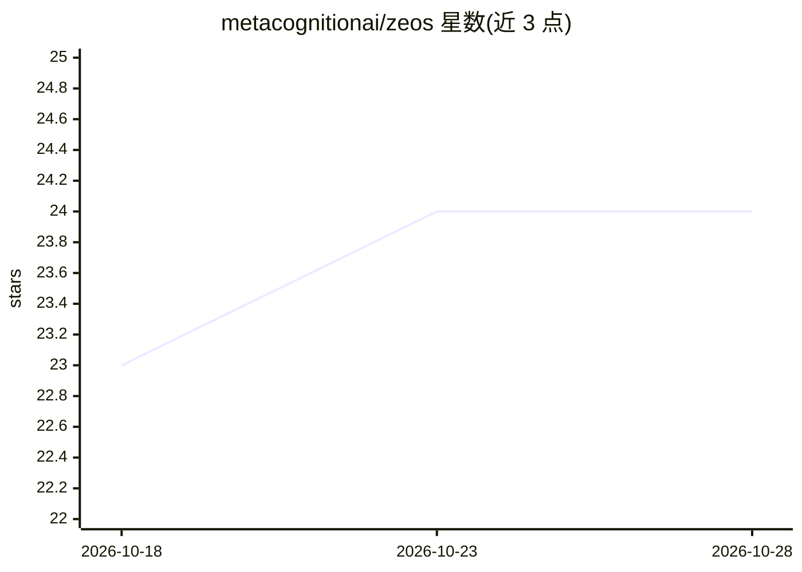

# metacognitionai/zeos

⭐ 24 · Python · AGPL-3.0 · 推送 2026-10-19 · [GitHub](https://github.com/metacognitionai/zeos) · [官网](https://github.com/metacognitionai/zeos/tree/main/docs/ProjectDescription) · 组织维护

**面向 LLM 任务的类操作系统内核：优先级抢占调度与确定性重放**

将实时操作系统的编程范式应用于 transformer 驱动系统：以任务描述符层级组织 LLM 作业，由内核执行优先级抢占式调度（在 token 边界内切换），管道提供数据流与阻塞调度，中断驱动切换，并保存挂起作业状态以支持恢复；恢复时注入世界变化 diff。内容携带来源环标，效果在管道边界做能力检查，将提示注入纳入受管故障类别。以 Python 包与源码方式提供，演示可接 Claude API 或本地 llama.cpp Qwen。作者声明为初始版本，API 与日志格式可能变化。

## 筛选速览

| 维度 | 判定 | 备注 |
|---|---|---|
| AI 角色 | `ai-ecosystem` | LLM/agent 周边工具 |
| 许可风险 | `viral` | AGPL-3.0 |
| 部署形态 | `library` | 以包/库形式分发 |
| 模型依赖 | — | README 未给出锁定关系 |
| 硬件要求 | — | 无带数字的原话,不猜 |
| 安装摩擦 | `low` | 无编译、无系统依赖或容器化 |
| 成熟度 | `idea` | |

## 能力要点

- 内核负责优先级抢占调度，作业阻塞于管道而非轮询
- 挂起状态栈与恢复时注入世界变化 diff
- 提示注入作为受管故障类：来源环标与管道边界能力检查
- 演示可接 Claude API 或本地 llama.cpp，内核无法区分后端

## 适用场景

- 为多 LLM 作业构建抢占式调度与中断响应系统
- 构建需要挂起/恢复且保持世界一致性的 agent 系统
- 以结构化机制而非拒绝策略应对恶意指令

## 场景标签

`Agent 框架` · 领域:Agent 开发

## 证据(README 行号)

> L9: ZEOS programs complex, real-time, transformer-mediated systems the way real-time
> L23: - **Scheduling belongs to a kernel, not the model** -- jobs block on pipes at zero

## 星数曲线

2026-10-18 23 → 2026-10-28 24（+1）

---
*卡片 v1 · prompt 1.4 · 生成 2026-10-27 · 置信度 high · 依据 README sha `5561c768edde` · [字段定义](../../DATASET.md)*
