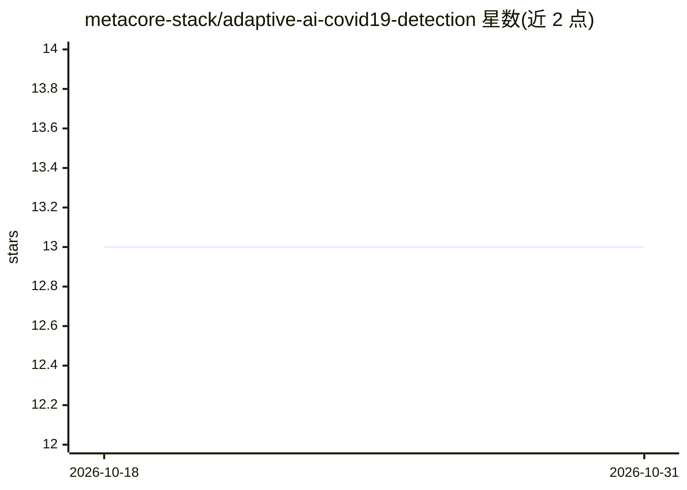

# metacore-stack/adaptive-ai-covid19-detection

⭐ 13 · Python · MIT · 推送 2026-09-04 · [GitHub](https://github.com/metacore-stack/adaptive-ai-covid19-detection) · 个人维护

**胸部影像 COVID-19 检测的训练评测研究工作区**

面向 SIIM-FISABIO-RSNA 挑战赛的端到端科研工作区：覆盖 DICOM 数据预处理、多任务分类+分割、YOLOv5/EfficientDet/Faster R-CNN 检测训练、伪标签循环与集成评测。提供分层 k 折划分、TTA 评估与可视化 demo notebook，并报告各模型 mAP 指标与排行榜成绩。需自行获取竞赛数据集，多 GPU CUDA 环境下开发，生成伪标签时内存需求达 64–128 GB。

## 筛选速览

| 维度 | 判定 | 备注 |
|---|---|---|
| AI 角色 | `ai-native` | 本体是模型或模型工具 |
| 许可风险 | `permissive` | MIT |
| 部署形态 | `library` | 以包/库形式分发 |
| 模型依赖 | — | README 未给出锁定关系 |
| 硬件要求 | — | 无带数字的原话,不猜 |
| 安装摩擦 | `medium` | 含编译或系统依赖之一 |
| 成熟度 | — | 结构信号不足 |

## 能力要点

- 分类+肺野定位+混浊影检测三类模型族的完整训练脚本
- 跨检测器聚合的伪标签循环（阈值过滤置信预测）
- 分层 k 折数据划分与 TTA 评估工具
- 报告各模型 mAP@0.5 与公开/私有榜单成绩

## 适用场景

- 复现或改进 SIIM COVID-19 检测竞赛方案
- 在胸部 X 光数据上训练分类/检测模型并做伪标签增强
- 组织放射影像检测实验并跟踪可复现指标

## 场景标签

`科研工具` `模型训练` `目标检测` · 领域:学习与行业

## 证据(README 行号)

> L5: Radiology Guardians is an end-to-end research workspace for learning, validating, and packaging thoracic imaging det
> L8: - Full training recipes covering multi-task classification, lung localization, and opacity detection.

## 星数曲线

2026-10-18 13 → 2026-10-31 13（+0）

---
*卡片 v1 · prompt 1.4 · 生成 2026-10-31 · 置信度 mid · 依据 README sha `b0791f65299a` · [字段定义](../../DATASET.md)*
