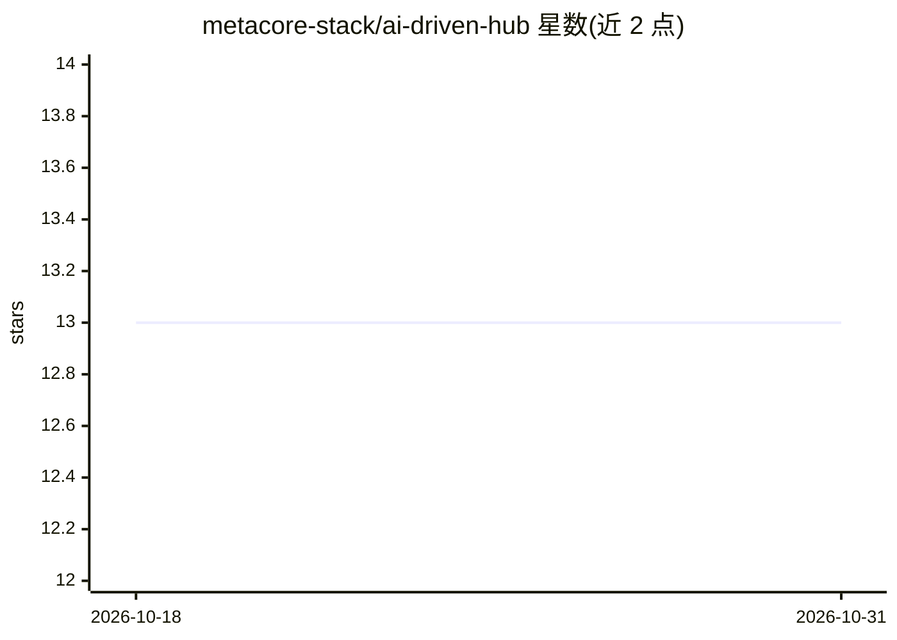

# metacore-stack/ai-driven-hub

⭐ 13 · TypeScript · 推送 2025-11-13 · [GitHub](https://github.com/metacore-stack/ai-driven-hub) · [官网](https://ai-powered-analytics-dashboard-pearl.vercel.app/) · 组织维护

**AI 增强的分析仪表盘：统一多渠道指标并提供趋势解读**

基于 Next.js App Router、React 18 与 Recharts 构建的 Web 分析仪表盘，将运营、营销与产品信号合并在单一视图中，通过机器学习将原始指标转写为可读的要点叙述，支持分段钻取、群组对比与异常呈现，数据目前来自 mock-data 模拟的实时刷新流。提供浅色/深色主题。异常检测自动告警、可嵌入小组件、团队工作区为规划中功能。通过 npm 安装依赖并以 npm run dev 启动。

## 筛选速览

| 维度 | 判定 | 备注 |
|---|---|---|
| AI 角色 | `ai-enhanced` | 去掉 AI 部分产品仍成立 |
| 许可风险 | `none` | — |
| 部署形态 | `library` | 以包/库形式分发 |
| 模型依赖 | — | README 未给出锁定关系 |
| 硬件要求 | — | 无带数字的原话,不猜 |
| 安装摩擦 | `low` | 无编译、无系统依赖或容器化 |
| 成熟度 | — | 结构信号不足 |

## 能力要点

- 运营/营销/产品信号合并为统一遥测视图
- 机器学习将原始数字转写为人类可读要点
- use-real-time-data 钩子周期性刷新关键指标
- 浅色/深色主题切换

## 适用场景

- 在一个仪表盘中查看各增长渠道的实时指标
- 钻取细分人群并对比不同群组的数据
- 阅读由指标自动生成的趋势解读

## 场景标签

`数据分析` · 领域:效率与自动化

## 证据(README 行号)

> L3: InsightFlow Nexus is an AI-augmented intelligence hub that streams live metrics, interprets trends, and paints a sin
> L8: - **Narrative analytics**: Transform raw numbers into human-readable takeaways backed by machine learning.

## 星数曲线

2026-10-18 13 → 2026-10-31 13（+0）

---
*卡片 v1 · prompt 1.4 · 生成 2026-10-31 · 置信度 mid · 依据 README sha `fd9c05656f29` · [字段定义](../../DATASET.md)*
