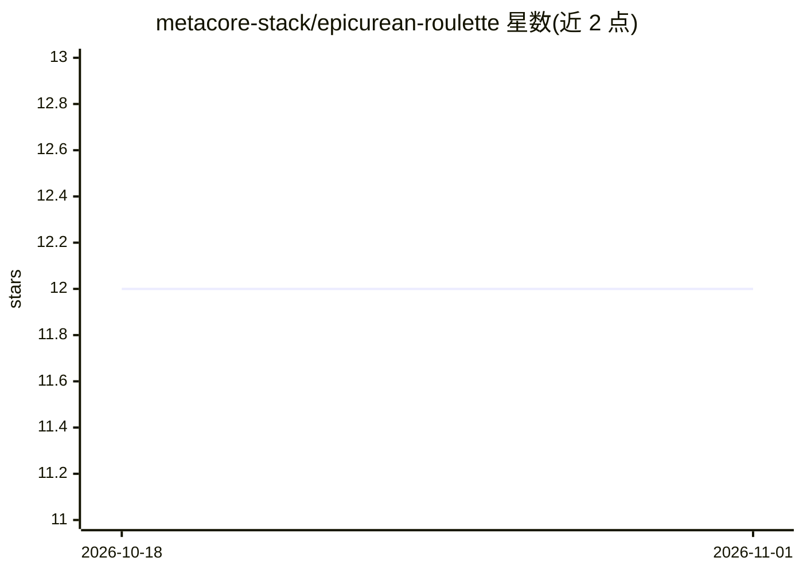

# metacore-stack/epicurean-roulette

⭐ 12 · JavaScript · 推送 2025-11-13 · [GitHub](https://github.com/metacore-stack/epicurean-roulette) · [官网](https://dinnerdecider.vercel.app/) · 组织维护

**晚餐决策 Web 应用：结合心情、位置与群组偏好的餐厅推荐**

基于 Next.js App Router、Tailwind CSS 与 Supabase 的晚餐选择应用，通过多步骤流程（/dinnerdecider）结合心情线索、位置上下文与群组选择给出推荐。架构上由 DinnerContext 同步会话状态，aiRecommender、fetchNearbyRestaurants 等模块封装外部请求并带回退逻辑；另含升级付费、推荐激励与分析埋点。README 面向维护者，提供克隆仓库、npm 安装、npm run dev 启动的本地运行步骤与分支、质检、调试约定。

## 筛选速览

| 维度 | 判定 | 备注 |
|---|---|---|
| AI 角色 | `ai-enhanced` | 去掉 AI 部分产品仍成立 |
| 许可风险 | `none` | — |
| 部署形态 | `library` | 以包/库形式分发 |
| 模型依赖 | — | README 未给出锁定关系 |
| 硬件要求 | — | 无带数字的原话,不猜 |
| 安装摩擦 | `low` | 无编译、无系统依赖或容器化 |
| 成熟度 | — | 结构信号不足 |

## 能力要点

- 多步骤晚餐决策流程（randomize/output/group 等路径）
- aiRecommender 封装 AI 推荐请求并提供回退
- Supabase 服务承载数据与逻辑层
- 含付费升级路径、推荐激励与埋点

## 适用场景

- 在晚餐选择困难时获得结合心情与位置的推荐
- 群组场景下共同决策用餐去处
- 按季节、饮食标签等上下文信号浏览餐厅建议

## 场景标签

`推荐系统` · 领域:学习与行业

## 证据(README 行号)

> L10: |Data & Logic|Supabase services, contextual AI helpers, and restaurant feeds|
> L13: The app orchestrates mood cues, location context, and group choices to deliver a playful yet informative recommenda

## 星数曲线

2026-10-18 12 → 2026-11-01 12（+0）

---
*卡片 v1 · prompt 1.4 · 生成 2026-11-01 · 置信度 mid · 依据 README sha `d77c098d90cb` · [字段定义](../../DATASET.md)*
