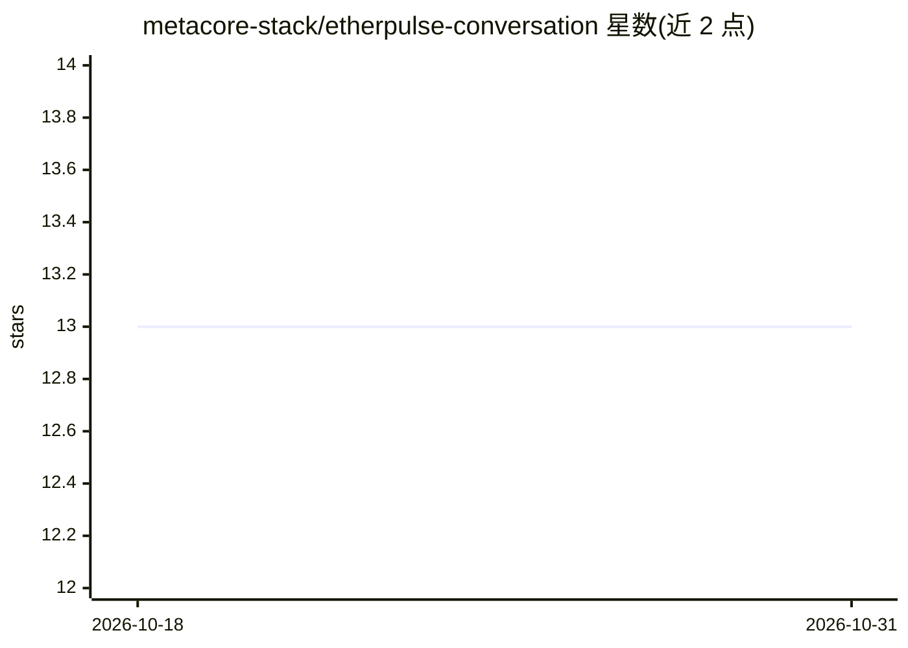

# metacore-stack/etherpulse-conversation

⭐ 13 · TypeScript · 推送 2025-11-13 · [GitHub](https://github.com/metacore-stack/etherpulse-conversation) · [官网](https://ether-conversation.vercel.app/) · 组织维护

**基于 Puter 无服务器 API 的浏览器端 AI 对话工作区**

使用 React + TypeScript 构建的浏览器端对话工作区：通过 Puter 的无服务器推理 API 流式获取模型回复，提供线程化对话历史、markdown 渲染、自适应头像与客户端本地持久化。面向希望在浏览器中原型化助手、测试提示词工作流或嵌入对话体验的开发者。以 Vite 项目形式提供，npm install 后 npm run dev 启动开发服务器，需在 .env 中配置 Puter API key。

## 筛选速览

| 维度 | 判定 | 备注 |
|---|---|---|
| AI 角色 | `ai-native` | 本体是模型或模型工具 |
| 许可风险 | `none` | — |
| 部署形态 | `library` | 以包/库形式分发 |
| 模型依赖 | — | README 未给出锁定关系 |
| 硬件要求 | — | 无带数字的原话,不猜 |
| 安装摩擦 | `low` | 无编译、无系统依赖或容器化 |
| 成熟度 | — | 结构信号不足 |

## 能力要点

- 通过 Puter 推理服务流式返回模型响应
- 线程化对话历史与 markdown 渲染
- 客户端本地存储使对话在刷新后保留
- Vite + React + TypeScript 模块化组件，可拆分复用

## 适用场景

- 在浏览器中快速原型化 AI 助手
- 测试提示词驱动的对话工作流
- 将对话体验嵌入现有 Web 项目

## 场景标签

`AI 助手` `聊天机器人` · 领域:对话与助手

## 证据(README 行号)

> L3: EtherPulse Conversational Studio is an AI-native chat workspace that fuses Puter’s serverless APIs with a React + Ty
> L7: - **Live Puter Connectivity** — Stream responses from Puter-backed inference services with minimal setup.

## 星数曲线

2026-10-18 13 → 2026-10-31 13（+0）

---
*卡片 v1 · prompt 1.4 · 生成 2026-10-31 · 置信度 high · 依据 README sha `5793515b0898` · [字段定义](../../DATASET.md)*
