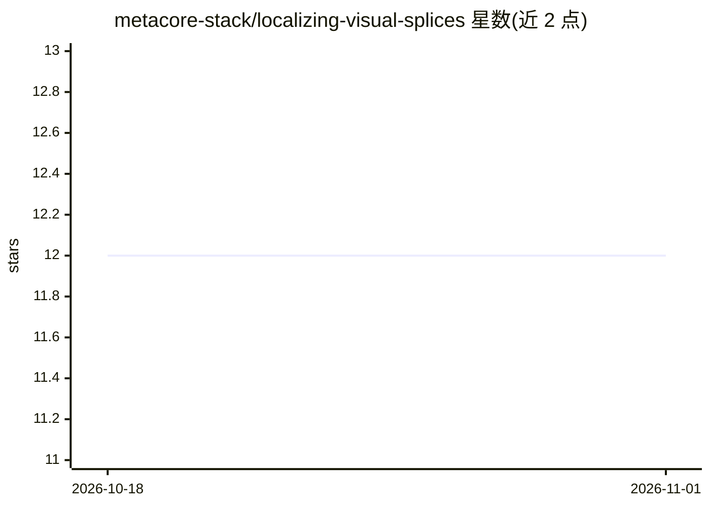

# metacore-stack/localizing-visual-splices

⭐ 12 · Python · 推送 2025-11-13 · [GitHub](https://github.com/metacore-stack/localizing-visual-splices) · 个人维护

**检测并定位图像拼接篡改区域的研究工具包**

BrightCut 是用于识别合成图像中篡改区域的端到端研究工具包：结合卷积主干网络与精修头，生成高分辨率定位掩膜以标记疑似编辑区域。支持 Columbia 拼接数据集，提供数据准备脚本（patch 与全分辨率两种流程）、可断点续训的训练工具、可视化对比工具与评估脚本（像素精度、mIoU）。通过 pip 安装依赖后以 Python 脚本驱动训练与评估，需自行获取 Columbia 数据集。

## 筛选速览

| 维度 | 判定 | 备注 |
|---|---|---|
| AI 角色 | `ai-native` | 本体是模型或模型工具 |
| 许可风险 | `none` | — |
| 部署形态 | `library` | 以包/库形式分发 |
| 模型依赖 | — | README 未给出锁定关系 |
| 硬件要求 | — | 无带数字的原话,不猜 |
| 安装摩擦 | `low` | 无编译、无系统依赖或容器化 |
| 成熟度 | — | 结构信号不足 |

## 能力要点

- 卷积主干 + 精修头生成高分辨率篡改定位掩膜
- 支持 patch 与全分辨率两种数据准备流程
- 提供断点续训的训练工具与训练监控摘要
- 评估脚本计算像素精度与 mIoU

## 适用场景

- 检测合成图像并定位拼接篡改区域
- 在 Columbia 拼接数据集上训练篡改检测模型
- 对比预测掩膜与真值标注进行定性分析

## 场景标签

`目标检测` · 领域:感知与多模态

## 证据(README 行号)

> L5: BrightCut is an end-to-end research toolkit for identifying tampered regions within composite imagery. It couples co
> L47: Sample outputs provided below demonstrate label predictions, predicted masks, and ground-truth annotations. Use `sc

## 星数曲线

2026-10-18 12 → 2026-11-01 12（+0）

---
*卡片 v1 · prompt 1.4 · 生成 2026-11-01 · 置信度 mid · 依据 README sha `aa1d212cd5fc` · [字段定义](../../DATASET.md)*
