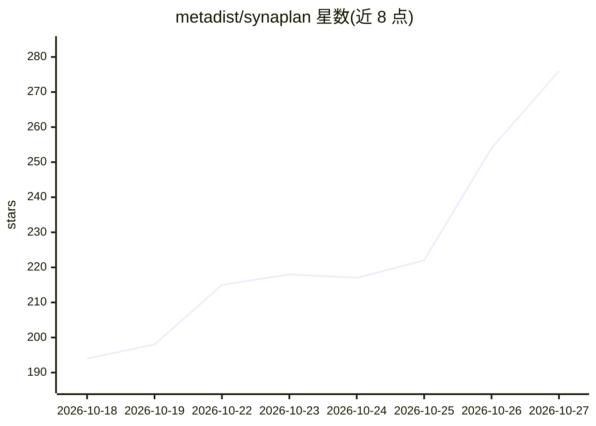

# metadist/synaplan

⭐ 276 · PHP · Apache-2.0 · 推送 2026-10-26 · [GitHub](https://github.com/metadist/synaplan) · [官网](https://www.synaplan.com) · 组织维护

**开源自托管 AI 平台：多模型聊天、RAG、站点组件与成本展示**

PHP/Symfony 实现的自托管 AI 平台（Apache-2.0）：接入 OpenAI、Anthropic、Gemini、Groq、Mistral、xAI 及本地 Ollama 等多家模型供应商，在 UI 内按任务切换模型；支持将上传文档做语义搜索（RAG）、生成图像/视频/音频、通过代码片段嵌入网站聊天组件、WhatsApp/邮件/Outlook 等多渠道接入，并提供 MCP server/client 与 Anthropic 兼容端点。每条回答显示花费成本。部署以 Docker Compose 为主，完整栈约 4-5.3 GB，另有精简版与离线/内网部署路径。

## 筛选速览

| 维度 | 判定 | 备注 |
|---|---|---|
| AI 角色 | `ai-native` | 本体是模型或模型工具 |
| 许可风险 | `permissive` | Apache-2.0 |
| 部署形态 | `desktop` | 安装包/桌面程序 |
| 模型依赖 | local-ok | 支持本地模型 |
| 硬件要求 | — | 无带数字的原话,不猜 |
| 安装摩擦 | `low` | 无编译、无系统依赖或容器化 |
| 成熟度 | — | 结构信号不足 |

## 能力要点

- 每条聊天回答展示其模型调用成本
- 将请求拆为任务图（提取→摘要→生成→回复），按任务选模型
- RAG 文档语义搜索与跨网站/WhatsApp/邮件的多渠道助手
- 插件、REST API、MCP server/client 与 Anthropic 兼容端点扩展

## 适用场景

- 团队自托管统一入口，接入多家云模型与本地 Ollama
- 把内部文档变成知识库做带出处的问答
- 在自己网站上嵌入带人工接管的聊天组件
- 在内网/离线环境运行 AI 助手并追踪回答成本

## 场景标签

`AI 助手` `聊天机器人` `RAG` · 领域:对话与助手

## 证据(README 行号)

> L5: **Try it hosted** or **run it yourself in three minutes** — open-source, self-hosted AI platform (PHP/Symfony): chat
> L51: - **Hundreds of models, one place.** OpenAI, Anthropic, Google Gemini, Groq, Mistral, xAI, HuggingFace, sovereign E
> L52: - **The planner spends the expensive model only where it matters.** A request becomes a small task graph (extract →

## 星数曲线

2026-10-18 194 → 2026-10-27 276（+82）

---
*卡片 v1 · prompt 1.4 · 生成 2026-10-22 · 置信度 high · 依据 README sha `77607cc9ebfd` · [字段定义](../../DATASET.md)*
