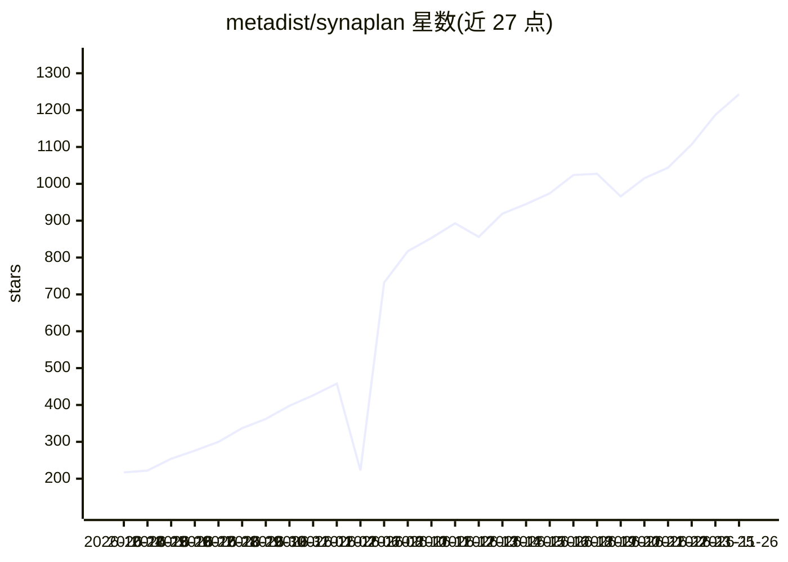

# metadist/synaplan

⭐ 1,243 · PHP · Apache-2.0 · 推送 2026-11-25 · [GitHub](https://github.com/metadist/synaplan) · [官网](https://www.synaplan.com) · 组织维护

**自托管 AI 助手平台：知识库+多模型+多渠道接入**

开源自托管平台，将文档作为知识库构建 agent，并接入网页聊天组件、WhatsApp、邮件、Outlook、Nextcloud/ownCloud 等渠道。本地模型（Ollama）与云端模型可混用，每条回答显示所用模型与价格，敏感任务可人工审批后发出。技术栈为 Symfony+Vue、MariaDB VECTOR/Qdrant、Redis，提供 MCP server/client、Anthropic 兼容端点与插件系统；自托管免费，托管版为付费计划。

## 筛选速览

| 维度 | 判定 | 备注 |
|---|---|---|
| AI 角色 | `ai-ecosystem` | LLM/agent 周边工具 |
| 许可风险 | `permissive` | Apache-2.0 |
| 部署形态 | `self-host` | docker 或自建部署 |
| 模型依赖 | local-ok | 支持本地模型 |
| 硬件要求 | — | 无带数字的原话,不猜 |
| 安装摩擦 | `low` | 无编译、无系统依赖或容器化 |
| 成熟度 | — | 结构信号不足 |

## 能力要点

- 本地与云端模型并行，每条回答标注模型与成本
- 同一助手覆盖网页、WhatsApp、邮件、Outlook、Nextcloud/ownCloud 渠道
- 提供 MCP server/client、Anthropic 兼容 /v1/messages 端点与插件系统
- 多种部署路径：Docker 镜像、Linux 安装脚本、Kubernetes Helm、Coolify、一键托管

## 适用场景

- 在企业内部文档上构建问答助手并部署到网站
- 通过 WhatsApp 和邮件自动回复客户咨询并人工审批外发
- 敏感数据留在本地 Ollama 模型上运行，满足合规要求

## 场景标签

`AI 助手` `聊天机器人` `RAG` · 领域:对话与助手

## 证据(README 行号)

> L5: Build agents on your own documents and put them wherever work happens: web, WhatsApp, email, Outlook, Nextcloud and 
> L23: The same assistant answers on your website, in WhatsApp, by email, in Outlook and inside Nextcloud and ownCloud. Se
> L100: Symfony and Vue, MariaDB VECTOR or Qdrant, Redis, Docker. The core is the app, the database and Redis. Local AI, o

## 星数曲线

2026-10-24 217 → 2026-11-26 1,243（+1,026）

---
*卡片 v1 · prompt 1.4 · 生成 2026-11-25 · 置信度 high · 依据 README sha `50f6034d0178` · [字段定义](../../DATASET.md)*
