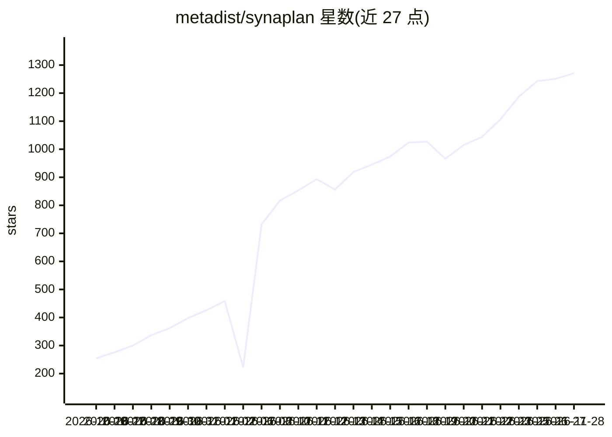

# metadist/synaplan

⭐ 1,271 · PHP · Apache-2.0 · 推送 2026-11-27 · [GitHub](https://github.com/metadist/synaplan) · [官网](https://www.synaplan.com) · 组织维护

**开源自托管 AI 平台：把知识库助手接入网页/WhatsApp/邮件等渠道**

自托管的团队 AI 平台：在自有文档上构建 agent，通过网页聊天、网站挂件、WhatsApp、邮件、Outlook、Nextcloud 等渠道回答；本地模型（Ollama）与云模型可混用，每条回答显示所用模型与成本，敏感任务可人工审批后发出。技术栈为 Symfony/Vue、MariaDB VECTOR 或 Qdrant、Redis，提供 MCP 服务器/客户端、Anthropic 兼容 /v1/messages 端点与插件系统。Docker Compose 部署，需 8 GB RAM，Apache-2.0 许可。

## 筛选速览

| 维度 | 判定 | 备注 |
|---|---|---|
| AI 角色 | `ai-native` | 本体是模型或模型工具 |
| 许可风险 | `permissive` | Apache-2.0 |
| 部署形态 | `self-host` | docker 或自建部署 |
| 模型依赖 | local-ok | 支持本地模型 |
| 硬件要求 | — | 无带数字的原话,不猜 |
| 安装摩擦 | `low` | 无编译、无系统依赖或容器化 |
| 成熟度 | — | 结构信号不足 |

## 能力要点

- 同一助手覆盖网页、WhatsApp、邮件、Outlook、Nextcloud/ownCloud 渠道
- 本地模型与云模型混用，每条回答标注模型与价格
- 提供 MCP 服务器与客户端、Anthropic 兼容 /v1/messages 端点和插件系统
- 多种部署方式：Compose、Helm、Linux 安装脚本、Coolify、Railway 等

## 适用场景

- 在自建服务器上搭建基于企业文档的问答助手
- 让同一个 AI 助手同时回应网站访客与 WhatsApp/邮件咨询
- 对数据合规有要求时用本地模型处理敏感问题

## 场景标签

`AI 助手` `聊天机器人` `RAG` `文档问答` · 领域:对话与助手

## 证据(README 行号)

> L5: Build agents on your own documents and put them wherever work happens: web, WhatsApp, email, Outlook, Nextcloud and 
> L25: The same assistant answers on your website, in WhatsApp, by email, in Outlook and inside Nextcloud and ownCloud. Se
> L102: Symfony and Vue, MariaDB VECTOR or Qdrant, Redis, Docker. The core is the app, the database and Redis. Local AI, o

## 星数曲线

2026-10-26 254 → 2026-11-28 1,271（+1,017）

---
*卡片 v1 · prompt 1.4 · 生成 2026-11-26 · 置信度 high · 依据 README sha `7fc64d488781` · [字段定义](../../DATASET.md)*
