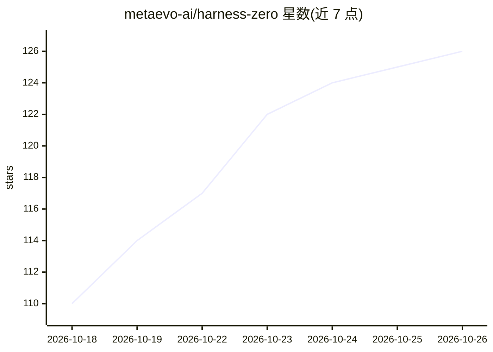

# metaevo-ai/harness-zero

⭐ 126 · Python · Apache-2.0 · 推送 2026-10-09 · [GitHub](https://github.com/metaevo-ai/harness-zero) · 组织维护

**把优化 agent harness 的行为蒸馏进模型权重的训练框架**

面向 LLM 研究者与开发者的 harness 蒸馏方法实现：训练期让一个 harnessing agent 按私有参考 harness 审阅并改写学生的每条响应，再对审阅后的轨迹做 SFT（LoRA，经 Tinker），使模型在部署时仅用最小 harness（单一 bash 工具）即可保留优化 harness 带来的增益。rollout 在本地 Docker 沙箱（Harbor）中运行，支持 OpenAI/Azure/OpenRouter 路由，附带三个基准任务集与 HuggingFace 上的 Qwen3.5-9B 蒸馏权重。Apache-2.0 许可。

## 筛选速览

| 维度 | 判定 | 备注 |
|---|---|---|
| AI 角色 | `ai-ecosystem` | LLM/agent 周边工具 |
| 许可风险 | `permissive` | Apache-2.0 |
| 部署形态 | `None` |  |
| 模型依赖 | locked-api |  |
| 硬件要求 | — | 无带数字的原话,不猜 |
| 安装摩擦 | `low` | 无编译、无系统依赖或容器化 |
| 成熟度 | — | 结构信号不足 |

## 能力要点

- harnessing agent 在训练期逐条审阅/改写学生响应
- 对审阅后轨迹做 LoRA SFT，部署时无需优化 harness
- rollout 运行于本地 Docker 沙箱（Harbor）
- 提供 SpreadsheetBench/AppWorld/USPTO 任务集与三个蒸馏 checkpoint

## 适用场景

- 复现或扩展 harness 蒸馏训练流程
- 在最小 harness 下部署获得增益的蒸馏模型
- 研究 agent 行为向模型权重的内化

## 场景标签

`微调` · 领域:训练与推理

## 证据(README 行号)

> L9: Agent harnesses — the external systems that mediate model–environment interaction — can substantially improve agent 
> L34: 2. **Agent-as-harness trajectory collection.** The student runs under a fixed, minimal
> L36: 3. **Train & deploy.** SFT on the reviewed trajectories (masking any reviewer-perspective

## 星数曲线

2026-10-18 110 → 2026-10-26 126（+16）

---
*卡片 v1 · prompt 1.4 · 生成 2026-10-23 · 置信度 high · 依据 README sha `996a7673004f` · [字段定义](../../DATASET.md)*
