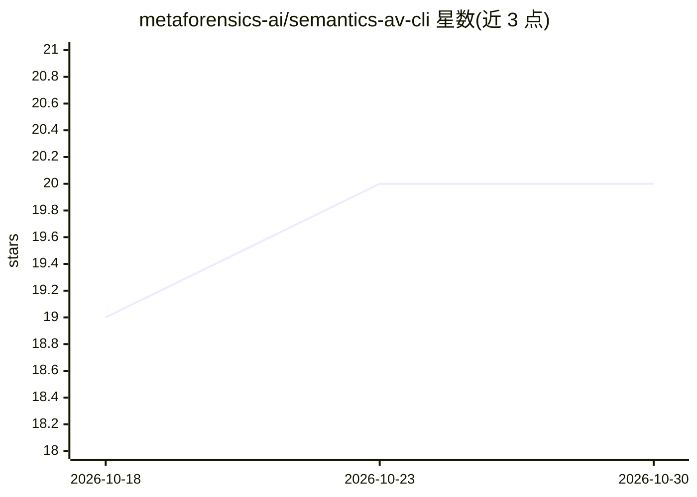

# metaforensics-ai/semantics-av-cli

⭐ 20 · C++ · NOASSERTION · 推送 2026-05-10 · [GitHub](https://github.com/metaforensics-ai/semantics-av-cli) · [官网](http://semanticsav.ai/) · 组织维护

**面向 Linux 的离线 AI 恶意软件扫描 CLI**

开源 CLI（MIT）封装专有 SDK（EULA）的 AI 杀毒引擎：通过学习到的结构模式而非签名识别恶意文件，离线扫描 PE/ELF 与嵌套压缩包，支持守护进程、REST API 与 Unix Socket 集成。可解释裁决与云端威胁情报为可选付费/订阅服务（需 API key，仅上传加密分析载荷）。支持 x86_64/aarch64 Linux，通过 install.sh 或源码构建安装，跨平台部署需商业许可。

## 筛选速览

| 维度 | 判定 | 备注 |
|---|---|---|
| AI 角色 | `ai-native` | 本体是模型或模型工具 |
| 许可风险 | `none` | NOASSERTION |
| 部署形态 | `desktop` | 安装包/桌面程序 |
| 模型依赖 | — | README 未给出锁定关系 |
| 硬件要求 | — | 无带数字的原话,不猜 |
| 安装摩擦 | `medium` | 含编译或系统依赖之一 |
| 成熟度 | — | 结构信号不足 |

## 能力要点

- 零网络本地扫描，SDK 无联网能力，文件不上传
- 识别 PE/ELF 及 ZIP/TAR/7Z/RAR 嵌套归档，含解压炸弹防护
- 守护进程 + REST API + Unix Socket（零拷贝 fd 传递）集成
- 可选云端 Intelligence 层提供可解释裁决与攻击战役归因

## 适用场景

- Linux 服务器/终端离线扫描免安装签名的恶意文件
- 通过 REST API 把扫描能力嵌入安全流水线
- 个人、商业与服务交付场景的免费 Linux 扫描（EULA 范围内）

## 场景标签

`网络安全` · 领域:学习与行业

## 证据(README 行号)

> L8: > **Free, Offline, AI-Native Malware Scanner for Linux**
> L20: SemanticsAV is an AI-native antivirus engine designed to solve the limitations of traditional signature-based detec
> L31: |**SDK**|AI-native offline malware scanner. Detects threats locally without internet connection using learned patte

## 星数曲线

2026-10-18 19 → 2026-10-30 20（+1）

---
*卡片 v1 · prompt 1.4 · 生成 2026-10-28 · 置信度 high · 依据 README sha `c0c0c00a6552` · [字段定义](../../DATASET.md)*
