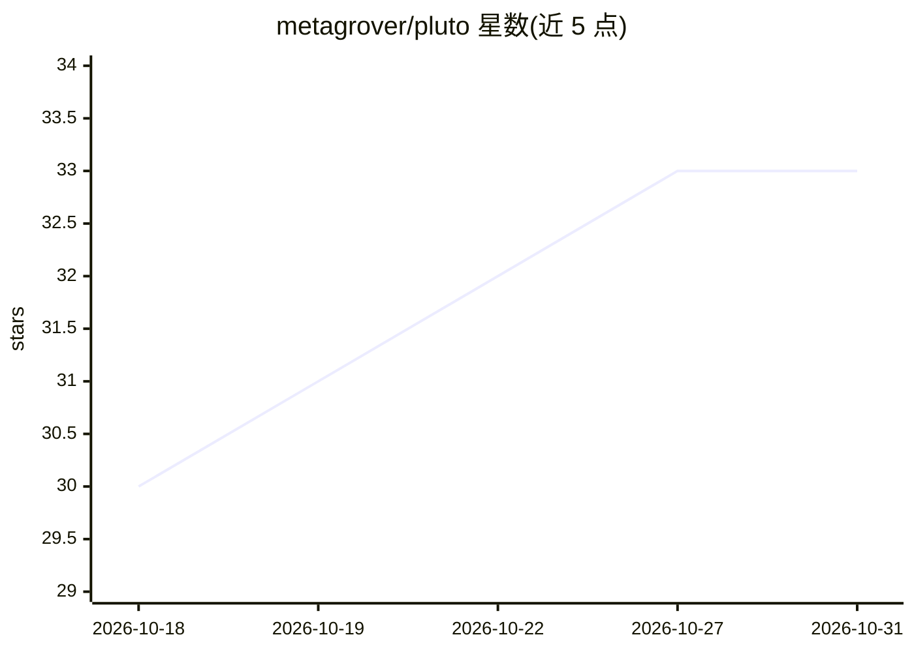

# metagrover/pluto

⭐ 33 · TypeScript · MIT · 推送 2026-10-30 · [GitHub](https://github.com/metagrover/pluto) · [官网](https://metagrover.github.io/get-pluto) · 个人维护

**Mac 本地优先的智能会议记录应用：录音、转写、生成笔记与跟进提醒**

面向 Apple Silicon Mac 用户的本地优先开源会议记录应用：直接录制麦克风与系统音频（无机器人入会），在本机完成转写与笔记生成；按人物、项目组织对话历史，跟踪各方承诺与截止提醒，提供 Voice ID 说话人识别与基于会议记录的问答聊天。AI 通过 Ollama 本地模型运行（默认 gemma4:12b 与 phi4-mini:3.8b），或接可选云服务；可选插件将笔记带入 ChatGPT。本地功能可离线使用，无需 API key。仅支持 Apple Silicon Mac（macOS 14.2+）。

## 筛选速览

| 维度 | 判定 | 备注 |
|---|---|---|
| AI 角色 | `ai-native` | 本体是模型或模型工具 |
| 许可风险 | `permissive` | MIT |
| 部署形态 | `None` |  |
| 模型依赖 | local-ok | 支持本地模型 |
| 硬件要求 | — | 无带数字的原话,不猜 |
| 安装摩擦 | `low` | 无编译、无系统依赖或容器化 |
| 成熟度 | — | 结构信号不足 |

## 能力要点

- 本地录音与转写，无需机器人入会
- 跟踪所有人的承诺与截止日期提醒
- Voice ID 说话人识别与会议问答聊天
- 默认经 Ollama 本地模型运行，可离线使用

## 适用场景

- 开完会后自动生成会议笔记与待办，避免遗漏承诺
- 按人物或项目回溯过往会议中的决策与对话
- 在本地完成录音转写，会议数据不出 Mac

## 场景标签

`语音识别` `文档问答` · 领域:知识与检索

## 证据(README 行号)

> L16: Pluto is a local-first, open-source meeting notes app for Apple Silicon Macs.
> L38: - **Choose where AI runs.** Use local models through Ollama or an optional cloud provider.
> L45: 2. **Review.** Stop recording, let Pluto transcribe and generate notes, then check

## 星数曲线

2026-10-18 30 → 2026-10-31 33（+3）

---
*卡片 v1 · prompt 1.4 · 生成 2026-10-26 · 置信度 high · 依据 README sha `bf8aa8150525` · [字段定义](../../DATASET.md)*
