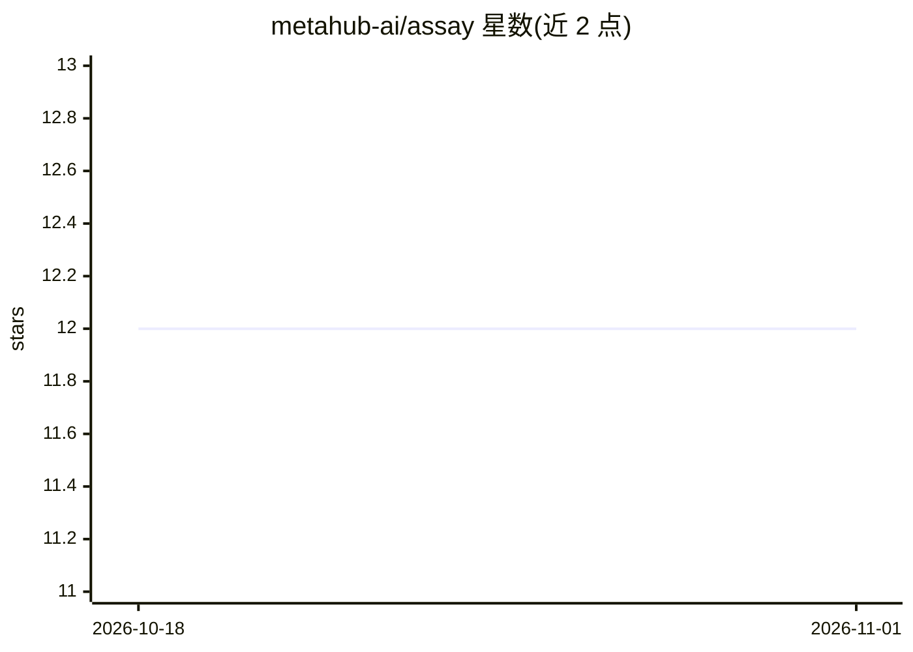

# metahub-ai/assay

⭐ 12 · TypeScript · Apache-2.0 · 推送 2026-10-03 · [GitHub](https://github.com/metahub-ai/assay) · [官网](https://metahub.ai) · 组织维护

**AI 工件（skills/MCP/agents）的可复现审计与行为评测框架**

面向 AI 生态安全的评测框架，审计对象为 skills、MCP 服务器、agents、插件。静态层读取工件内容执行 43 项检查，离线约一秒，默认不授予网络/模型/沙箱权限；行为层在沙箱（podman 本地或 E2B 云端）内由驱动模型按测试用例真实调用工件，再由独立裁判模型按 rubric 打分，并叠加确定性安全扫描与三种对抗探针（提示注入、越权、破坏性请求）。报告记录内容摘要与解析 commit，支持 replay 离线复验判决、SARIF 输出与 CI 回归 diff。无运行时依赖（约 240KB 自包含 JS，Node 20+）。给开发者与企业在安装/分发前审计 AI 工件行为。

## 筛选速览

| 维度 | 判定 | 备注 |
|---|---|---|
| AI 角色 | `ai-ecosystem` | LLM/agent 周边工具 |
| 许可风险 | `permissive` | Apache-2.0 |
| 部署形态 | `library` | 以包/库形式分发 |
| 模型依赖 | local-ok | 支持本地模型 |
| 硬件要求 | — | 无带数字的原话,不猜 |
| 安装摩擦 | `low` | 无编译、无系统依赖或容器化 |
| 成熟度 | — | 结构信号不足 |

## 能力要点

- 静态 43 项检查离线运行，默认零授权（无网络/模型/沙箱）
- 沙箱内驱动模型真实调用工件 + 独立裁判模型评分 + 确定性安全扫描
- 三种对抗探针（提示注入/越权/破坏性请求）独立计分
- assay replay 离线复验判决，SARIF 输出与 CI 回归 diff

## 适用场景

- 安装第三方 skill 或 MCP 服务器前先审计其实际行为
- 在 CI 中对工件评测并只在回归时失败
- 对已发布评级离线复验判决是否成立

## 场景标签

`模型评测` `网络安全` · 领域:评测与运维

## 证据(README 行号)

> L14: Assay answers the second question. It reads what is inside an artifact, and
> L207: Everything above is static. This is the part that runs the artifact and judges
> L293: assay diff base.json head.json         # exits 1 only on a REGRESSION

## 星数曲线

2026-10-18 12 → 2026-11-01 12（+0）

---
*卡片 v1 · prompt 1.4 · 生成 2026-11-01 · 置信度 mid · 依据 README sha `9135512ec0ca` · [字段定义](../../DATASET.md)*
