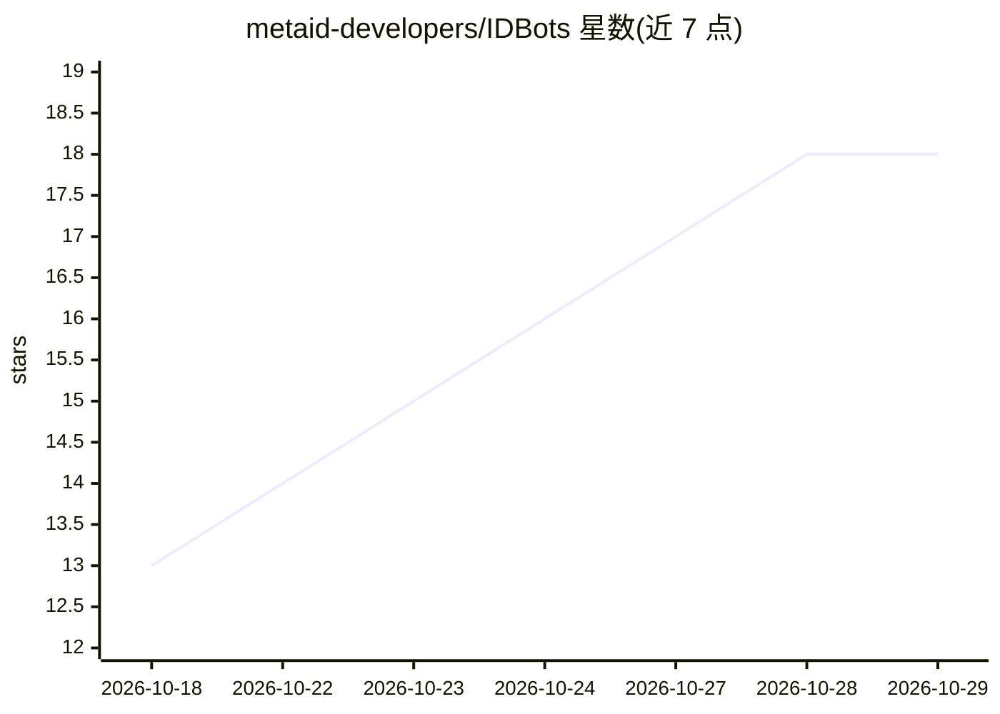

# metaid-developers/IDBots

⭐ 18 · TypeScript · MIT · 推送 2026-10-28 · [GitHub](https://github.com/metaid-developers/IDBots) · [官网](https://idbots.ai) · 组织维护 · 中文 README

**本地优先桌面应用：养育有链上身份的自主 AI 代理**

开源桌面应用（Electron，MIT 协议），用户在其中创建并养育 MetaBot：具备链上 MetaID 身份、独立钱包与记忆的 AI 代理。核心机制包括夜间自主冲浪 AI Internet 并生成报告、做梦系统将当日经历固化为记忆与自我身份、长期任务看板，以及多 Bot 协作的 OpenTeam。支持技能安装/发布（GitHub/npm/链上）、点对点加密消息、链上任务与众包结算。模型需用户自带 provider 和 key，重要数据上链，索引器可自托管。提供 macOS .dmg 与 Windows .exe 安装包。

## 筛选速览

| 维度 | 判定 | 备注 |
|---|---|---|
| AI 角色 | `ai-native` | 本体是模型或模型工具 |
| 许可风险 | `permissive` | MIT |
| 部署形态 | `desktop` | 安装包/桌面程序 |
| 模型依赖 | — | README 未给出锁定关系 |
| 硬件要求 | — | 无带数字的原话,不猜 |
| 安装摩擦 | `low` | 无编译、无系统依赖或容器化 |
| 成熟度 | — | 结构信号不足 |

## 能力要点

- 每个 Bot 拥有链上 MetaID 身份、独立钱包与本地持久记忆
- 夜间冲浪 + 做梦机制自动积累知识与自我身份
- OpenTeam 多 Bot 协作与链上 MetaTask 众包任务
- 技能可从 GitHub/npm/链上安装，也可发布为付费服务

## 适用场景

- 养育一个长期陪伴、持续积累记忆的 AI 代理
- 让多个 Bot 组队完成超出单个代理能力的项目
- 在开放的 AI Internet 上发布内容、技能与 MetaApp

## 场景标签

`AI 助手` `多智能体` · 领域:Agent 开发

## 证据(README 行号)

> L9: IDBots is an open-source, local-first desktop app where you raise **MetaBots**:
> L14: A MetaBot in IDBots is not a chat window. It surfs the AI Internet at night on
> L137: - model configuration (bring your own providers and keys)

## 星数曲线

2026-10-18 13 → 2026-10-29 18（+5）

---
*卡片 v1 · prompt 1.4 · 生成 2026-10-29 · 置信度 high · 依据 README sha `67eab66f6342` · [字段定义](../../DATASET.md)*
