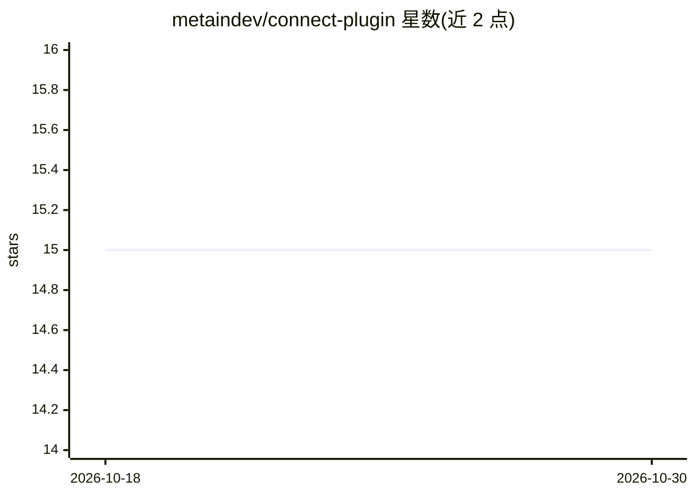

# metaindev/connect-plugin

⭐ 15 · Luau · 推送 2026-04-20 · [GitHub](https://github.com/metaindev/connect-plugin) · [官网](https://metain.dev) · 组织维护

**Roblox Studio 插件：把 Metain AI（Claude 驱动）接入 Studio 生成游戏内容**

Metain 官方的 Roblox Studio 插件，通过 WebSocket 与经认证的连接码将 Studio 会话连接到 Metain 的云端 AI（由 Claude 提供支持）。用户在 metain.dev/chat 输入需求后，AI 生成 Luau 代码并向插件下发命令，在 Studio 内实时创建/编辑脚本、实例、UI 层级与属性；所有 AI 操作记录在 Studio 撤销历史中，可单独回退。插件仅能在 Studio 会话内修改内容，官方提醒仅从 Creator Store（资产 ID 77655523450717）或本仓库安装以防仿冒。

## 筛选速览

| 维度 | 判定 | 备注 |
|---|---|---|
| AI 角色 | `ai-ecosystem` | LLM/agent 周边工具 |
| 许可风险 | `none` | — |
| 部署形态 | `None` |  |
| 模型依赖 | locked-api |  |
| 硬件要求 | — | 无带数字的原话,不猜 |
| 安装摩擦 | `low` | 无编译、无系统依赖或容器化 |
| 成熟度 | — | 结构信号不足 |

## 能力要点

- WebSocket 连接 + 连接码认证，AI 命令实时在 Studio 会话内执行
- 能力覆盖 Luau 脚本读写、实例操作、UI 层级生成、属性设置与代码探索
- AI 操作全部进入 Studio 撤销历史，可回退且不影响手动改动
- 官方警示仿冒插件风险并给出资产 ID 校验方法

## 适用场景

- 用自然语言描述需求，让 AI 在 Roblox Studio 里直接搭建游戏内容
- 让 AI 批量创建脚本、实例与 UI 层级
- 对 AI 改动不满意时通过撤销历史单独回退

## 场景标签

`代码生成` `编码 Agent` · 领域:编码与开发

## 证据(README 行号)

> L5: The official Roblox Studio plugin for Metain which builds Roblox games with AI, powered by Claude.
> L22: The plugin connects Roblox Studio to Metain's AI through a WebSocket connection. When you send a prompt on metain.d
> L30: |**Scripts**|Read, create, update and edit Luau scripts|

## 星数曲线

2026-10-18 15 → 2026-10-30 15（+0）

---
*卡片 v1 · prompt 1.4 · 生成 2026-10-30 · 置信度 high · 依据 README sha `f21060826158` · [字段定义](../../DATASET.md)*
