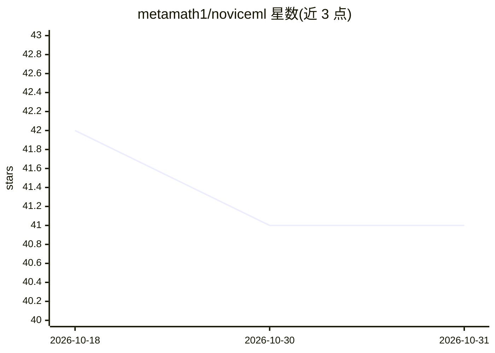

# metamath1/noviceml

⭐ 41 · Jupyter Notebook · 推送 2026-05-22 · [GitHub](https://github.com/metamath1/noviceml) · 个人维护

**机器学习/深度学习基础数学书籍的示例代码与网页演示仓库**

韩国图书《머신러닝·딥러닝에 필요한 기초 수학 with 파이썬》（인사이트， 2020）的配套代码仓库：提供第 1–10 章的 Jupyter Notebook（示例程序与绘图代码）及指数法则、极限等辅助资料，另含 4 个可直接在浏览器打开的网页应用（手算线性回归、简易分类器、偏导数演示、线性回归线性性确认）。Notebook 可在 Google Colab 一键运行，本地运行需 JupyterLab 与 Python 3+、numpy、pytorch 1.1+ 等依赖。源代码采用 MIT 许可，允许商用。

## 筛选速览

| 维度 | 判定 | 备注 |
|---|---|---|
| AI 角色 | `ai-knowledge` | 知识聚合/清单类 |
| 许可风险 | `none` | — |
| 部署形态 | `None` |  |
| 模型依赖 | — | README 未给出锁定关系 |
| 硬件要求 | — | 无带数字的原话,不猜 |
| 安装摩擦 | `low` | 无编译、无系统依赖或容器化 |
| 成熟度 | — | 结构信号不足 |

## 能力要点

- 第 1–10 章 Jupyter Notebook 示例与绘图代码
- 4 个浏览器可直接访问的交互式网页演示（线性回归/分类器/偏导数等）
- Notebook 支持 Open In Colab 一键运行

## 适用场景

- 配合原书学习机器学习基础数学
- 通过交互式网页直观理解线性回归、偏导数等概念
- 在 Colab 或本地 JupyterLab 环境运行书中示例

## 场景标签

`教程课程` · 领域:学习与行业

## 证据(README 行号)

> L3: 이 저장소는 『머신러닝·딥러닝에 필요한 기초 수학 with 파이썬(http://)』(인사이트, 2020)에서 사용하는 예제 코드들을 제공하고 있습니다.
> L9: |CHAP_01.ipynb|1장 예제 프로그램과 그래프 그리는 코드|

## 星数曲线

2026-10-18 42 → 2026-10-31 41（-1）

---
*卡片 v1 · prompt 1.4 · 生成 2026-10-25 · 置信度 high · 依据 README sha `386650129fed` · [字段定义](../../DATASET.md)*
