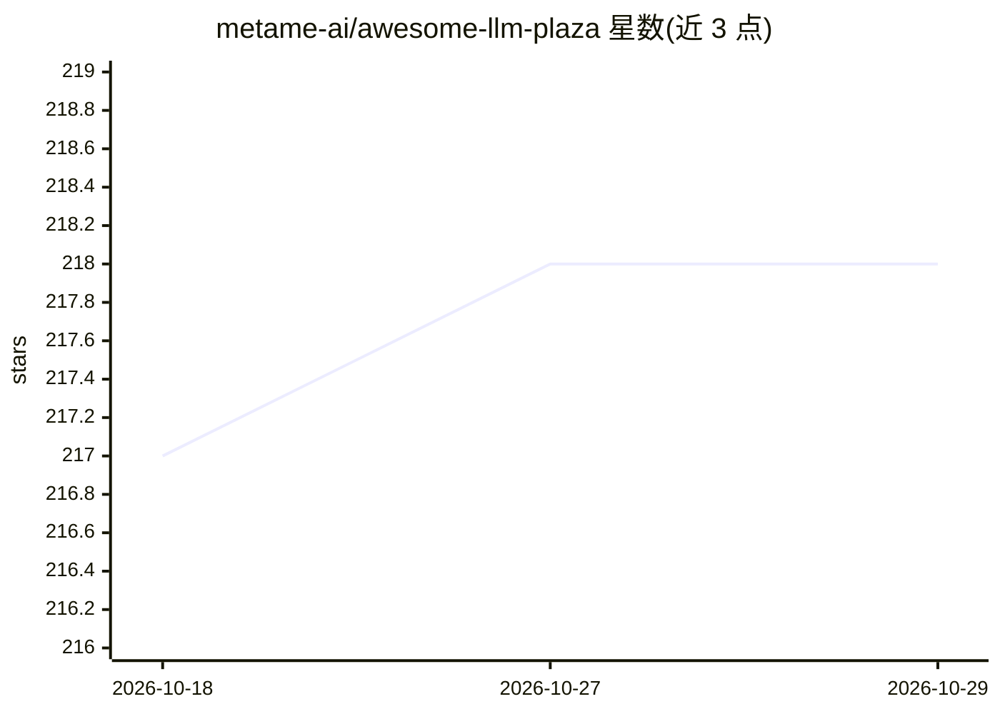

# metame-ai/awesome-llm-plaza

⭐ 218 · MIT · 推送 2025-11-02 · [GitHub](https://github.com/metame-ai/awesome-llm-plaza) · 个人维护 · 中文 README

**每日追踪 LLM 论文/项目/资源的分类策展清单**

每日从 arxiv、HuggingFace daily papers、Twitter(X)、GitHub trending、paper with code、微信等来源追踪 LLM 相关论文、项目与资源，按 20 个主题类别组织目录：Code LLM、Efficient LLM、Embodied AI、LLM Agent、Alignment、Application、Data、Eval、Hallucination、Long Context、RAG、Reasoning、RLHF、Security、Training、Open LLM、Vision-Language Models 等，每类下再细分 Survey、Projects、Products、Misc 等子目。以清单文档形式提供，含历史归档分册。

## 筛选速览

| 维度 | 判定 | 备注 |
|---|---|---|
| AI 角色 | `ai-knowledge` | 知识聚合/清单类 |
| 许可风险 | `permissive` | MIT |
| 部署形态 | `None` |  |
| 模型依赖 | — | README 未给出锁定关系 |
| 硬件要求 | — | 无带数字的原话,不猜 |
| 安装摩擦 | `low` | 无编译、无系统依赖或容器化 |
| 成熟度 | — | 结构信号不足 |

## 能力要点

- 每日自动追踪多来源的 LLM 论文与项目
- 20 个主题类别、每类多层子目录组织
- 来源覆盖 arxiv、HuggingFace、GitHub trending、微信等

## 适用场景

- 按主题检索 LLM 最新论文与开源项目
- 跟踪 RAG、Reasoning、RLHF 等细分方向的进展
- 查找 LLM 相关工具与产品条目

## 场景标签

`精选清单` · 领域:学习与行业

## 证据(README 行号)

> L3: Daily tracking of awesome audio papers, projects, and resources.
> L8: ## Contents

## 星数曲线

2026-10-18 217 → 2026-10-29 218（+1）

---
*卡片 v1 · prompt 1.4 · 生成 2026-10-22 · 置信度 high · 依据 README sha `979b91b1e542` · [字段定义](../../DATASET.md)*
