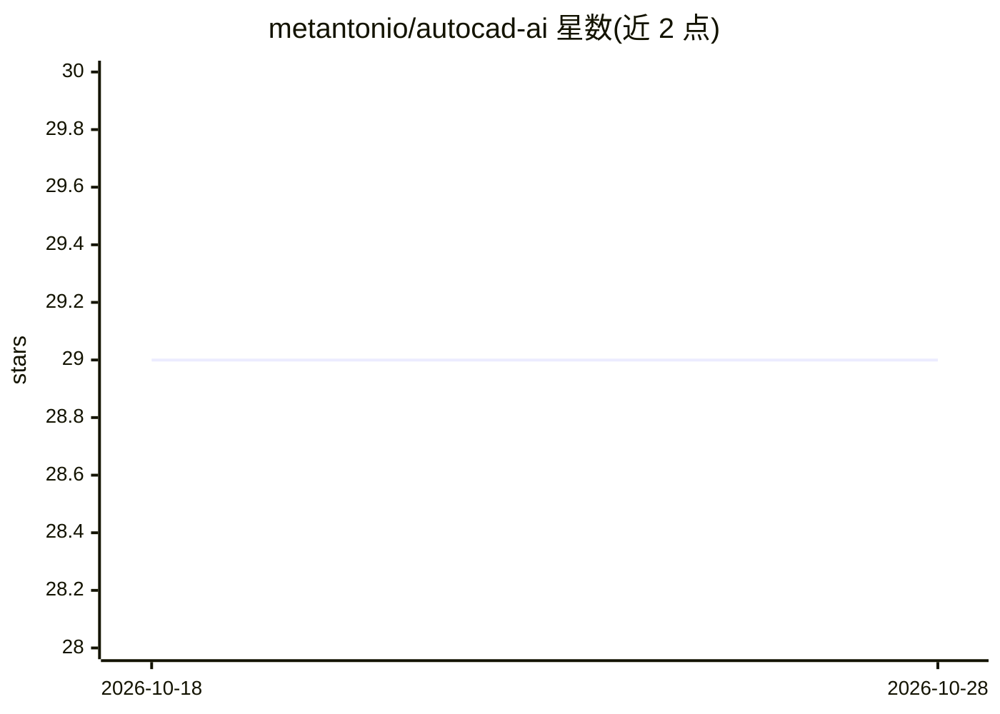

# metantonio/autocad-ai

⭐ 29 · Python · 推送 2025-12-23 · [GitHub](https://github.com/metantonio/autocad-ai) · 个人维护

**用自然语言控制 AutoCAD 绘图的 LLM 桥接工具**

在 LLM 与 AutoCAD/Revit 之间提供桥接：通过 Ollama tool-calling 解析自然语言意图，经 COM 自动化在 AutoCAD 中绘制点、线、圆、弧、样条等实体。要求运行前已打开 AutoCAD 并启动 Ollama，推荐模型 qwen2.5-coder:7b。提供交互式 CLI（python main.py），可用 PyInstaller 打包为单个 .exe 分发；.exe 无 .env 时回退默认配置（localhost:11434）。面向使用 AutoCAD 的开发者和设计人员。

## 筛选速览

| 维度 | 判定 | 备注 |
|---|---|---|
| AI 角色 | `ai-native` | 本体是模型或模型工具 |
| 许可风险 | `none` | — |
| 部署形态 | `desktop` | 安装包/桌面程序 |
| 模型依赖 | local-ok | 支持本地模型 |
| 硬件要求 | — | 无带数字的原话,不猜 |
| 安装摩擦 | `low` | 无编译、无系统依赖或容器化 |
| 成熟度 | — | 结构信号不足 |

## 能力要点

- 自然语言意图解析驱动 AutoCAD COM 自动化绘图
- 基于 Ollama tool-calling，推荐 qwen2.5-coder:7b
- 可编译为单个 .exe 便携分发
- 无 .env 时回退内置默认配置

## 适用场景

- 用自然语言在 AutoCAD 中画圆、画线等基本实体
- 将绘图指令对话化，减少手工命令操作
- 打包成 .exe 在装有 AutoCAD 的机器上分发使用

## 场景标签

`GUI 自动化` · 领域:效率与自动化

## 证据(README 行号)

> L3: This project provides a bridge between LLMs (via Ollama or other providers) and CAD software (AutoCAD and/or Revit).
> L9: - **LLM-Driven**: Powered by Ollama tool-calling for intelligent intent parsing.

## 星数曲线

2026-10-18 29 → 2026-10-28 29（+0）

---
*卡片 v1 · prompt 1.4 · 生成 2026-10-26 · 置信度 mid · 依据 README sha `95f16e97f475` · [字段定义](../../DATASET.md)*
