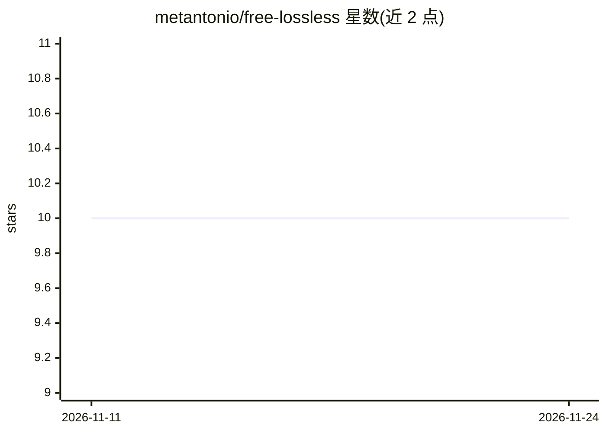

# metantonio/free-lossless

⭐ 10 · Python · 推送 2025-12-30 · [GitHub](https://github.com/metantonio/free-lossless) · 个人维护

**为老游戏生成 AI 补帧的 Windows 桌面工具**

面向 Windows 的非侵入式帧生成工具：通过 DXCAM/BitBlt 高速捕获游戏窗口画面，用 RIFE 模型在两帧之间计算并插入合成帧，再以透明覆盖层显示插帧结果。不注入游戏进程、不修改 GPU 管线，因此不依赖游戏引擎（DirectX/OpenGL/Vulkan 均可），适用于无原生 DLSS/FSR 补帧的游戏、模拟器等场景。通过 Python 虚拟环境运行，也可打包为约 2.63 GB 的独立 exe。

## 筛选速览

| 维度 | 判定 | 备注 |
|---|---|---|
| AI 角色 | `ai-native` | 本体是模型或模型工具 |
| 许可风险 | `none` | — |
| 部署形态 | `desktop` | 安装包/桌面程序 |
| 模型依赖 | — | README 未给出锁定关系 |
| 硬件要求 | — | 无带数字的原话,不猜 |
| 安装摩擦 | `low` | 无编译、无系统依赖或容器化 |
| 成熟度 | — | 结构信号不足 |

## 能力要点

- 基于 RIFE 模型的屏幕级帧插值，游戏外运行
- 非侵入式：不注入文件、不挂钩进程、不修改代码
- DirectML 加速，支持 NVIDIA/AMD/Intel GPU
- 引擎无关，兼容任意图形 API 的应用

## 适用场景

- 给不支持 DLSS/FSR 补帧的老游戏或模拟器游戏补帧
- 不想修改游戏文件或担心反作弊的情况下提升画面流畅度
- 在 AMD/Intel 等 GPU 上使用帧生成功能

## 场景标签

`图像视频处理` · 领域:感知与多模态

## 证据(README 行号)

> L5: Free Lossless is a high-performance, non-intrusive Frame Generation tool for Windows. It enhances game fluidity by c
> L12: 2. **AI Interpolation**: It uses the **RIFE AI model** to analyze the movement between two real frames and calculat

## 星数曲线

2026-11-11 10 → 2026-11-24 10（+0）

---
*卡片 v1 · prompt 1.4 · 生成 2026-11-19 · 置信度 high · 依据 README sha `d8d7850377bb` · [字段定义](../../DATASET.md)*
