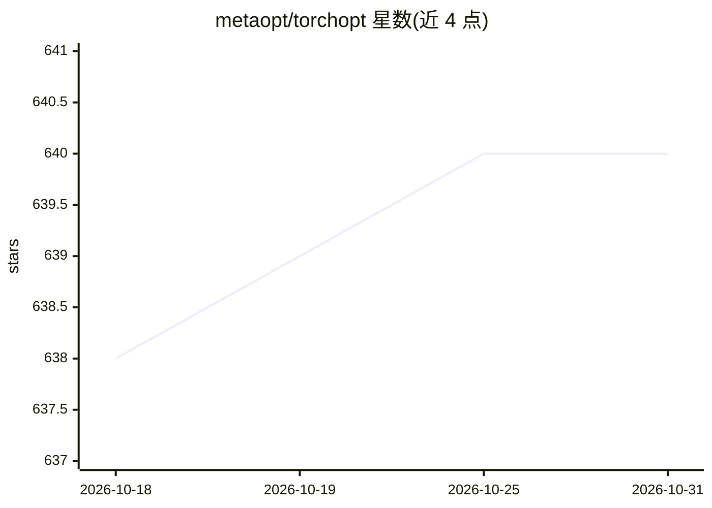

# metaopt/torchopt

⭐ 640 · Python · Apache-2.0 · 推送 2026-10-05 · [GitHub](https://github.com/metaopt/torchopt) · [官网](https://torchopt.readthedocs.io) · 组织维护

**基于 PyTorch 的可微分优化库，用于双层优化与元学习**

构建在 PyTorch 之上的可微分优化库，面向需要通过优化过程求导的研究者与开发者。提供三种求导模式（显式梯度、隐式梯度、零阶微分），同时提供 JAX 风格（Optax-Like）与 PyTorch 风格（OOP）两套 API。加速部分以 C++ OpenMP 与 CUDA 实现并经 pybind11 绑定，需设置 use_accelerated_op 开启；另提供基于 PyTorch RPC 的分布式训练与基于 torchviz 修改的梯度流可视化工具。附 MAML、MGRL、LOLA、iMAML 等示例。安装前需先自行安装 PyTorch。

## 筛选速览

| 维度 | 判定 | 备注 |
|---|---|---|
| AI 角色 | `ai-ecosystem` | LLM/agent 周边工具 |
| 许可风险 | `permissive` | Apache-2.0 |
| 部署形态 | `library` | 以包/库形式分发 |
| 模型依赖 | — | README 未给出锁定关系 |
| 硬件要求 | — | 无带数字的原话,不猜 |
| 安装摩擦 | `medium` | 含编译或系统依赖之一 |
| 成熟度 | — | 结构信号不足 |

## 能力要点

- 三种求导模式：显式梯度、隐式微分、零阶微分
- 功能式与面向对象双 API，兼容 functorch 的 JAX 风格编程
- C++ OpenMP/CUDA 加速的可微分优化器（use_accelerated_op 开启）
- 基于 PyTorch RPC 的分布式训练与 C++ 实现的 PyTree（OpTree）

## 适用场景

- 实现 MAML、iMAML 等元学习算法
- 在 PyTorch 中做双层优化与可微分优化研究
- 以函数式风格编写可组合的优化器训练流程

## 场景标签

 · 领域:深度学习/优化库

## 证据(README 行号)

> L16: **TorchOpt** is an efficient library for differentiable optimization built upon PyTorch.
> L83: TorchOpt supports three differentiation modes.

## 星数曲线

2026-10-18 638 → 2026-10-31 640（+2）

---
*卡片 v1 · prompt 1.4 · 生成 2026-10-21 · 置信度 high · 依据 README sha `56c60b4d393c` · [字段定义](../../DATASET.md)*
