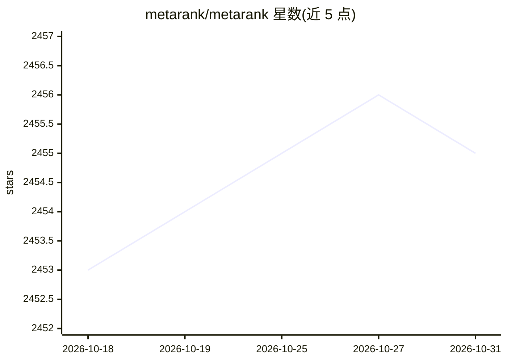

# metarank/metarank

⭐ 2,455 · Scala · Apache-2.0 · 推送 2026-10-06 · [GitHub](https://github.com/metarank/metarank) · [官网](https://metarank.ai) · 组织维护

**开源实时个性化排序服务：为搜索与推荐做 Learning-to-Rank 重排**

基于 Scala 的自托管排序服务，面向已有搜索引擎或推荐系统的团队：读取点击、购买等访客信号，开箱计算 CTR、referer、User-Agent、时间等数十种排序特征，通过 LambdaMART/XGBoost 做二级重排实现实时个性化；另支持协同过滤推荐与基于 LLM 双编码/交叉编码的语义神经搜索。AutoML 自动特征生成与模型重训，支持 A/B 多模型部署。以无状态云原生服务运行（Redis 管理状态），可水平扩展；提供 Docker 镜像，standalone 模式一条命令完成数据导入、训练与 API 启动。

## 筛选速览

| 维度 | 判定 | 备注 |
|---|---|---|
| AI 角色 | `ai-ecosystem` | LLM/agent 周边工具 |
| 许可风险 | `permissive` | Apache-2.0 |
| 部署形态 | `self-host` | docker 或自建部署 |
| 模型依赖 | — | README 未给出锁定关系 |
| 硬件要求 | — | 无带数字的原话,不猜 |
| 安装摩擦 | `low` | 无编译、无系统依赖或容器化 |
| 成熟度 | — | 结构信号不足 |

## 能力要点

- LambdaMART/XGBoost 二级重排实现实时个性化
- 开箱计算 CTR/referer/User-Agent 等数十种排序特征
- 支持 LLM 双编码与交叉编码模式的语义搜索
- AutoLM 自动特征生成与模型重训、A/B 多模型部署

## 适用场景

- 在 Elasticsearch/OpenSearch 之上叠加 Learning-to-Rank 优化现有搜索
- 为电商列表构建协同过滤与语义内容推荐
- 利用点击与购买信号对搜索结果做实时个性化重排

## 场景标签

`推荐系统` `语义搜索` · 领域:知识与检索

## 证据(README 行号)

> L16: Metarank is an open-source ranking service. It can help you to build a personalized semantic/neural search and reco
> L25: With Metarank, you can make your existing search and recommendations **smarter**:
> L41: * Semantic search: use state-of-the-art LLMs to make your Elasticsearch/OpenSearch understand the meaning of your q

## 星数曲线

2026-10-18 2,453 → 2026-10-31 2,455（+2）

---
*卡片 v1 · prompt 1.4 · 生成 2026-10-21 · 置信度 mid · 依据 README sha `b589fd6bf04b` · [字段定义](../../DATASET.md)*
