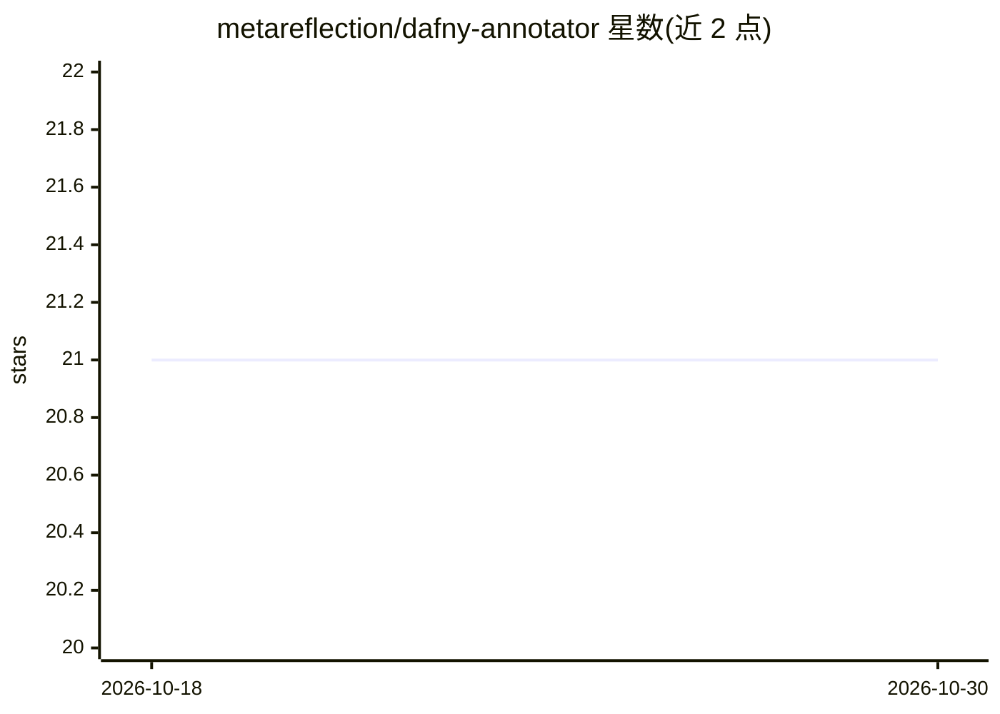

# metareflection/dafny-annotator

⭐ 21 · Python · MIT · 推送 2025-11-09 · [GitHub](https://github.com/metareflection/dafny-annotator) · [官网](https://dafny.org/blog/2025/06/21/dafny-annotator/) · 组织维护

**用 LLM 自动为 Dafny 程序补全验证注释的研究工具**

面向 Dafny 形式化验证的研究工具，包含两个组件：一是 Annotator，用 LLM 加贪心搜索为已正确实现并带有前后置条件的方法自动插入断言、不变式与递减子句，插入后调用 Dafny 验证器校验，直到程序通过验证；二是 DafnySynth，基于可扩展 Editor 架构（IdeaProposer、LLMImplementer、LLMEditor 等）增量生成多样化 Dafny 训练程序。支持从已标注程序抽取训练样本并微调 LLM，附实验驱动脚本与可 uvicorn 启动的注释服务。

## 筛选速览

| 维度 | 判定 | 备注 |
|---|---|---|
| AI 角色 | `ai-native` | 本体是模型或模型工具 |
| 许可风险 | `permissive` | MIT |
| 部署形态 | `library` | 以包/库形式分发 |
| 模型依赖 | — | README 未给出锁定关系 |
| 硬件要求 | — | 无带数字的原话,不猜 |
| 安装摩擦 | `low` | 无编译、无系统依赖或容器化 |
| 成熟度 | — | 结构信号不足 |

## 能力要点

- LLM 引导的贪心搜索自动插入断言/不变式/递减子句并调用 Dafny 验证
- DafnySynth 基于 Edit Graph 与可扩展 Editor 架构合成训练数据
- 支持抽取训练样本并微调 Llama/CodeLlama 模型
- 提供 HTTP 注释服务（uvicorn）与端到端实验脚本

## 适用场景

- 让 LLM 为缺少注释的 Dafny 方法补全验证注解
- 合成多样化 Dafny 程序数据集用于微调
- 复现 Llama 3.1 8B / CodeLlama 7B 上的注释实验

## 场景标签

`代码生成` `微调` · 领域:编码与开发

## 证据(README 行号)

> L5: dafny-annotator is a tool that uses Large Language Models (LLMs) to automatically add logical annotations to Dafny p
> L9: 2. A synthetic training data generation method (*DafnySynth*) based on an extensible Editor architecture. This syste
> L32: This is the entry point for the actual annotator. This file implements the core greedy search algorithm that uses a

## 星数曲线

2026-10-18 21 → 2026-10-30 21（+0）

---
*卡片 v1 · prompt 1.4 · 生成 2026-10-28 · 置信度 high · 依据 README sha `9d597616f061` · [字段定义](../../DATASET.md)*
