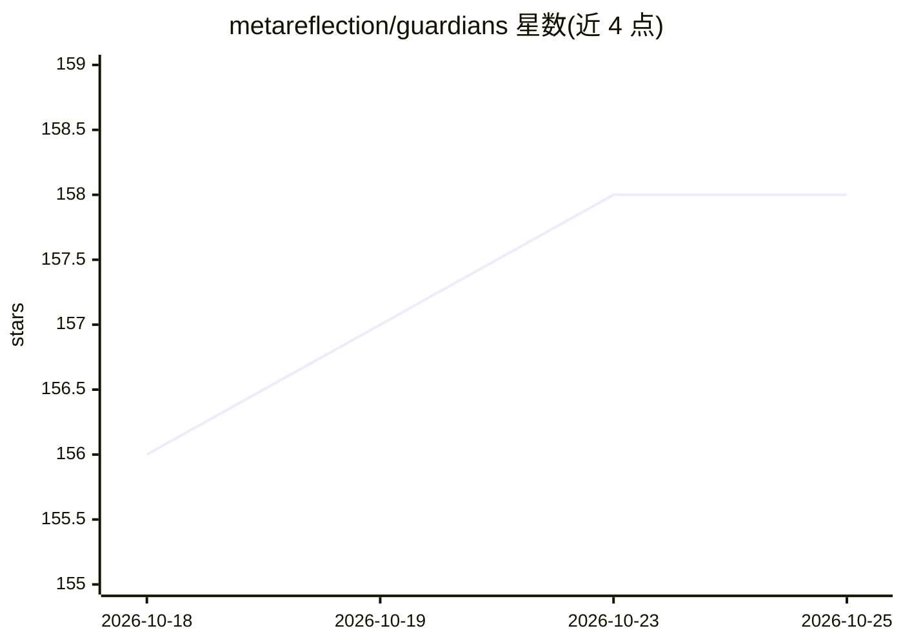

# metareflection/guardians

⭐ 158 · Python · MIT · 推送 2026-07-16 · [GitHub](https://github.com/metareflection/guardians) · 个人维护

**AI agent 工作流的形式化验证框架：静态检查后再执行**

实现 Erik Meijer 论文《Guardians of the Agents》(CACM 2026.1) 的想法：LLM 预先生成使用符号引用（而非真实数据）的结构化计划，静态验证器在工具执行前依据安全策略检查计划，仅验证通过的计划被执行。验证包含三项独立检查：污点分析、安全自动机、Z3 定理证明。核心约 1900 行，130 个测试，依赖 pydantic 与 z3-solver，验证本身无需 LLM 调用，要求 Python 3.11+。面向需要为 agent 工作流添加安全验证的开发者。

## 筛选速览

| 维度 | 判定 | 备注 |
|---|---|---|
| AI 角色 | `ai-ecosystem` | LLM/agent 周边工具 |
| 许可风险 | `permissive` | MIT |
| 部署形态 | `library` | 以包/库形式分发 |
| 模型依赖 | — | README 未给出锁定关系 |
| 硬件要求 | — | 无带数字的原话,不猜 |
| 安装摩擦 | `low` | 无编译、无系统依赖或容器化 |
| 成熟度 | — | 结构信号不足 |

## 能力要点

- 执行前静态验证：污点分析 + 安全自动机 + Z3 定理证明三项独立检查
- 计划使用符号引用（占位符）而非真实数据，验证无需 LLM 调用
- 运行时执行器同时检查 allowlist、前后置条件、自动机与预算
- 可选 litellm 适配器：真实 LLM 生成计划、验证器把关

## 适用场景

- 在 agent 工作流执行前拦截提示注入类攻击（如恶意邮件诱导外发数据）
- 为 LLM 生成的工具调用计划做静态安全策略检查
- 研究代码/数据分离思路在 agent 系统中的形式化验证

## 场景标签

`网络安全` · 领域:学习与行业

## 证据(README 行号)

> L3: Static verification for AI agent workflows.
> L13: using symbolic references (placeholders, not real data). A static
> L14: verifier checks the plan against a security policy before any tool

## 星数曲线

2026-10-18 156 → 2026-10-25 158（+2）

---
*卡片 v1 · prompt 1.4 · 生成 2026-10-23 · 置信度 high · 依据 README sha `cb3f1ad94912` · [字段定义](../../DATASET.md)*
