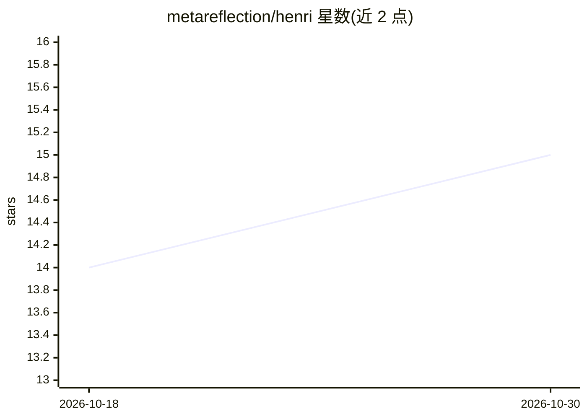

# metareflection/henri

⭐ 15 · Python · MIT · 推送 2026-02-11 · [GitHub](https://github.com/metareflection/henri) · 个人维护

**用 Python 实现的可魔改 agent 命令行工具**

面向终端用户的命令行编码 agent：通过对话调用 bash、文件读写编辑、grep/glob 等工具执行任务，支持流式输出与权限管理（逐次确认/会话内全允许/自动拒绝）。可接入 Anthropic API、AWS Bedrock、Google Gemini、Vertex AI、Ollama 及 OpenAI 兼容服务（如 vLLM）。提供 Hook 机制以 Python 文件扩展自定义工具与权限配置，架构简洁便于阅读和扩展，附带教程。

## 筛选速览

| 维度 | 判定 | 备注 |
|---|---|---|
| AI 角色 | `ai-native` | 本体是模型或模型工具 |
| 许可风险 | `permissive` | MIT |
| 部署形态 | `library` | 以包/库形式分发 |
| 模型依赖 | local-ok | 支持本地模型 |
| 硬件要求 | — | 无带数字的原话,不猜 |
| 安装摩擦 | `low` | 无编译、无系统依赖或容器化 |
| 成熟度 | — | 结构信号不足 |

## 能力要点

- 多 LLM 提供商接入：Anthropic/Bedrock/Gemini/Vertex/Ollama/OpenAI 兼容
- 工具系统：bash、文件读写编辑、grep/glob
- 权限管理与 Hook 系统（自定义工具、自动允许、拒绝提示）
- 可子类化 Tool 与 Provider 扩展新工具和新提供商

## 适用场景

- 在终端通过对话让 agent 执行 shell 命令与文件操作
- 学习或魔改一个小型 agent CLI 的实现
- 通过 Hook 接入自定义工具构建专用 agent

## 场景标签

`编码 Agent` · 领域:编码与开发

## 证据(README 行号)

> L3: Henri is a small, hackable agent CLI in Python, with explicit control via tools, permissions, and hooks.
> L11: - **Tool system** - bash, file read/write/edit capabilities, grep/glob, ...

## 星数曲线

2026-10-18 14 → 2026-10-30 15（+1）

---
*卡片 v1 · prompt 1.4 · 生成 2026-10-30 · 置信度 high · 依据 README sha `d3e72e764bde` · [字段定义](../../DATASET.md)*
