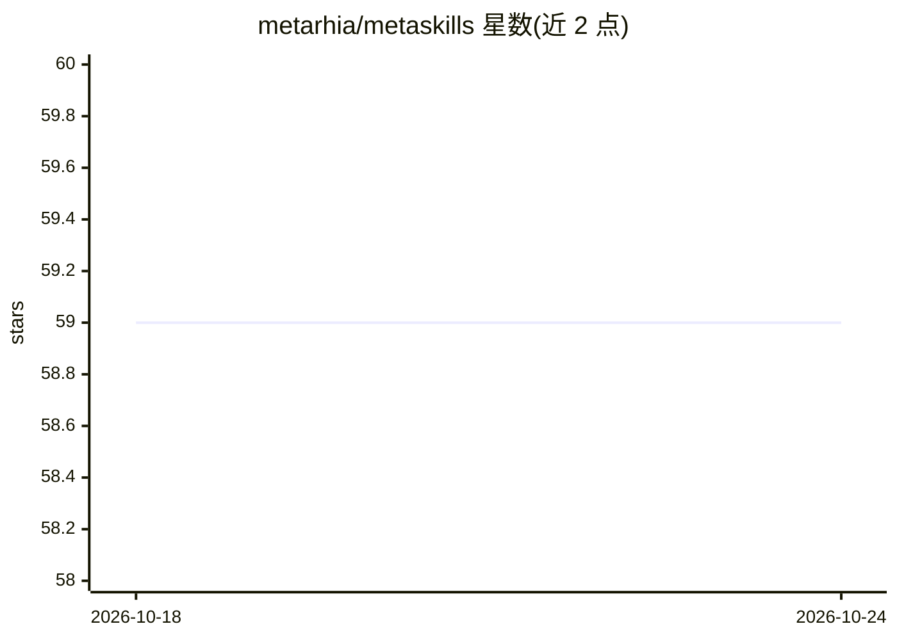

# metarhia/metaskills

⭐ 59 · JavaScript · MIT · 推送 2026-08-06 · [GitHub](https://github.com/metarhia/metaskills) · 组织维护

**Metarhia 技术栈的 AI 助手/IDE 技能指令集（SKILL.md 集合）**

面向 Metarhia 技术栈的 agent 技能包：以 SKILL.md 文件形式提供可复用的编码规范、模式、架构与领域知识指令，供 AI 助手与 IDE（Cursor、VS Code、Claude Code、Windsurf 等）加载使用。通过 npx metaskills 命令自动检测已安装 IDE 并在其技能目录下创建符号链接，无需复制文件；运行一次即可补齐缺失链接并清理过期链接。内置技能覆盖 JS/TS 命名规范、数据结构、GoF 模式、错误处理、npm 发布等，以 npm 包形式分发。

## 筛选速览

| 维度 | 判定 | 备注 |
|---|---|---|
| AI 角色 | `ai-knowledge` | 知识聚合/清单类 |
| 许可风险 | `permissive` | MIT |
| 部署形态 | `library` | 以包/库形式分发 |
| 模型依赖 | — | README 未给出锁定关系 |
| 硬件要求 | — | 无带数字的原话,不猜 |
| 安装摩擦 | `low` | 无编译、无系统依赖或容器化 |
| 成熟度 | — | 结构信号不足 |

## 能力要点

- 以 SKILL.md 格式组织的可复用 AI 指令集（编码规范/模式/架构/领域知识）
- npx metaskills 自动检测 IDE 并以符号链接方式挂载技能
- 支持 Cursor、Claude、Windsurf、VS Code、Gemini、Antigravity 等 7 类目标目录
- 内置 js-conventions、js-gof、error-handling、npm-publish 等技能

## 适用场景

- 为我的 IDE 加载 Metarhia 风格的编码规范与模式指令
- 让 AI 助手遵循统一的 JavaScript/TypeScript 约定
- 项目内批量链接技能到多个 IDE

## 场景标签

`提示工程` · 领域:Agent 开发

## 证据(README 行号)

> L9: Agent skills for the Metarhia tech stack: reusable instructions for AI assistants and IDEs (Cursor, VS Code, Claude 
> L41: Skills live under `skills/<name>/SKILL.md`:

## 星数曲线

2026-10-18 59 → 2026-10-24 59（+0）

---
*卡片 v1 · prompt 1.4 · 生成 2026-10-24 · 置信度 high · 依据 README sha `90dc7338acac` · [字段定义](../../DATASET.md)*
