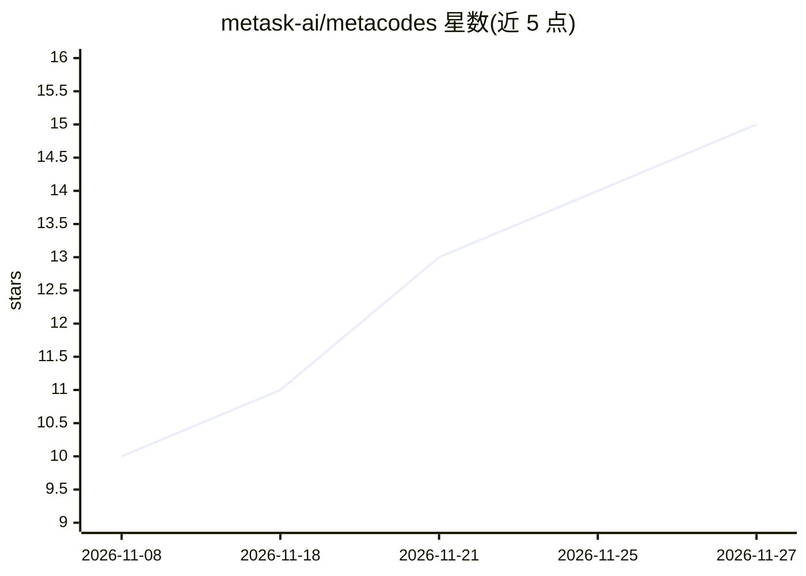

# metask-ai/metacodes

⭐ 15 · Zig · MIT · 推送 2026-11-26 · [GitHub](https://github.com/metask-ai/metacodes) · [官网](https://app.metask-ai.com) · 组织维护

**可嵌入任意宿主的 Zig 编码 agent 运行框架与 CLI**

用 Zig 从零编写的 coding-agent 框架：内核固定拥有 agent 循环、权限、预算与形式化判定，插件只能收紧策略不能放宽。对外提供多种嵌入面：Zig 模块、C ABI（sdk/ 内含 C/C++/Rust 绑定，另实验性提供 Python/Node 包）、headless NDJSON、HTTP/UDS 守护进程与 Web UI。附带 TinyKG 图记忆（BM25+图遍历，无向量库）、CLI swarm 多 agent 协作、Lean 4 形式化规则等实验特性。提供 macOS/Linux 安装脚本与 Windows 安装包，源码构建需 Zig 0.16；TinyKG 源码未公开，仅以 SHA-256 固定二进制分发。

## 筛选速览

| 维度 | 判定 | 备注 |
|---|---|---|
| AI 角色 | `ai-ecosystem` | LLM/agent 周边工具 |
| 许可风险 | `permissive` | MIT |
| 部署形态 | `None` |  |
| 模型依赖 | — | README 未给出锁定关系 |
| 硬件要求 | — | 无带数字的原话,不猜 |
| 安装摩擦 | `low` | 无编译、无系统依赖或容器化 |
| 成熟度 | — | 结构信号不足 |

## 能力要点

- 固定内核：插件无法绕过权限、预算与判定
- 多嵌入面：C ABI、Zig 模块、NDJSON headless、HTTP/UDS 守护进程、Web UI
- TinyKG 图记忆与持久任务 DAG，BM25 检索无向量库
- 多 agent：host 调度团队与 worktree 隔离的 CLI swarm

## 适用场景

- 把编码 agent 嵌入编辑器、CI 或桌面应用中运行
- 在服务器上以 headless/守护进程方式批量跑 agent 任务
- 需要长期记忆与任务 DAG 的多 agent 协作场景

## 场景标签

`编码 Agent` `Agent 框架` `Agent 记忆` `多智能体` · 领域:Agent 开发

## 证据(README 行号)

> L14: metacodes is a coding-agent harness written from scratch in Zig. You can use
> L17: inside surfaces that let any program host it. Those surfaces are a Zig module,
> L216: - **Model-agnostic.** It speaks Anthropic Messages, OpenAI Chat Completions and

## 星数曲线

2026-11-08 10 → 2026-11-27 15（+5）

---
*卡片 v1 · prompt 1.4 · 生成 2026-11-18 · 置信度 high · 依据 README sha `b0147d218535` · [字段定义](../../DATASET.md)*
