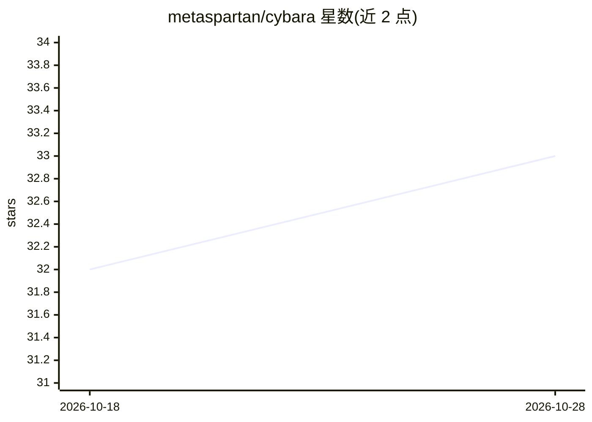

# metaspartan/cybara

⭐ 33 · TypeScript · MIT · 推送 2026-10-24 · [GitHub](https://github.com/metaspartan/cybara) · [官网](https://cybara.ai) · 组织维护

**自托管的持久 AI agent 工作区：编码、研究、自动化一体化运行时**

基于 Bun 网关的自托管 agent 工作区：通过单一网关运行持久化、可调用工具的 agent，会话、计划、产物与控制在 Web/Tauri、原生 macOS、CLI/TUI、移动端、ACP 与消息渠道间保持一致。支持托管、OAuth 与本地模型接入，提供使用量感知的账号池路由；内置 IDE/LSP/终端/浏览器预览/桌面控制与 iOS/Android 模拟器。可扩展插件、技能与 MCP 服务器，Lab 支持将真实运行转为可回放评测或训练数据。桌面端提供 macOS/Windows/Linux 安装包，另有 Docker 部署方式。

## 筛选速览

| 维度 | 判定 | 备注 |
|---|---|---|
| AI 角色 | `ai-native` | 本体是模型或模型工具 |
| 许可风险 | `permissive` | MIT |
| 部署形态 | `self-host` | docker 或自建部署 |
| 模型依赖 | local-ok | 支持本地模型 |
| 硬件要求 | — | 无带数字的原话,不猜 |
| 安装摩擦 | `low` | 无编译、无系统依赖或容器化 |
| 成熟度 | — | 结构信号不足 |

## 能力要点

- 单一 Bun 网关统一 Web/Tauri、macOS、CLI/TUI、移动端与消息渠道
- 托管/OAuth/本地模型接入，使用量感知账号池与可配置路由
- 插件、技能、MCP 服务器扩展与动态工具发现
- Lab 将真实运行转为可回放评测、基准与训练数据导出

## 适用场景

- 在桌面、终端和手机上持续运行编码与研究型 agent
- 通过消息渠道（Telegram/Slack 等）远程操控 agent 执行任务
- 将 agent 真实运行转为可回放的评测与训练数据

## 场景标签

`编码 Agent` `GUI 自动化` `浏览器自动化` · 领域:效率与自动化

## 证据(README 行号)

> L5:  A self-hosted agent workspace for coding, research, automation, and operations across desktop, terminal, mobile, an
> L7:  Cybara runs persistent, tool-using agents through one Bun gateway and keeps sessions, live activity,
> L65: Cybara is one operator-controlled runtime for:

## 星数曲线

2026-10-18 32 → 2026-10-28 33（+1）

---
*卡片 v1 · prompt 1.4 · 生成 2026-10-26 · 置信度 high · 依据 README sha `747bb44fd13e` · [字段定义](../../DATASET.md)*
