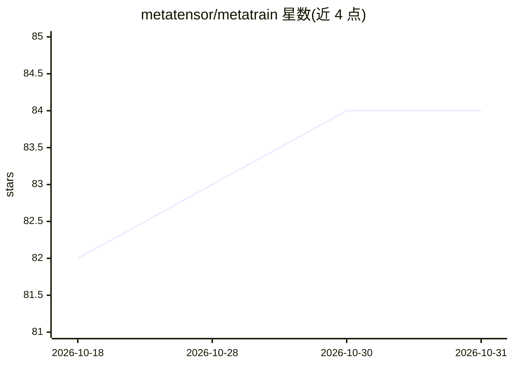

# metatensor/metatrain

⭐ 84 · Python · BSD-3-Clause · 推送 2026-10-30 · [GitHub](https://github.com/metatensor/metatrain) · [官网](http://docs.metatensor.org/metatrain/) · 组织维护

**原子体系机器学习势模型的统一训练与评估 CLI**

面向原子模拟的命令行训练中枢：通过统一 yaml 配置训练和评估多种机器学习势架构（PET、SOAP-BPNN、MACE、GAP、DPA3 等），并附带组合模型、缩放器、LLPR 不确定性量化等辅助架构。训练好的模型导出为独立文件，经 metatomic 接口直接在 ASE、LAMMPS、i-PI、TorchSim、ESPResSo 等分子动力学引擎中使用。兼容 TorchScript 的自定义架构可接入并获得训练评估接口与 MD 引擎兼容性。提供 pip 与 conda 安装，bash/zsh 命令补全。

## 筛选速览

| 维度 | 判定 | 备注 |
|---|---|---|
| AI 角色 | `ai-ecosystem` | LLM/agent 周边工具 |
| 许可风险 | `permissive` | BSD-3-Clause |
| 部署形态 | `library` | 以包/库形式分发 |
| 模型依赖 | — | README 未给出锁定关系 |
| 硬件要求 | — | 无带数字的原话,不猜 |
| 安装摩擦 | `low` | 无编译、无系统依赖或容器化 |
| 成熟度 | — | 结构信号不足 |

## 能力要点

- yaml 配置驱动的统一训练与评估界面
- 支持 PET、MACE、SOAP-BPNN、GAP、DPA3 等 9 种以上架构
- 模型导出后可直接用于 ASE/LAMMPS/i-PI 等 MD 引擎
- 含 LLPR 低成本不确定性量化等辅助架构

## 适用场景

- 我要为分子动力学模拟训练机器学习势
- 我想用统一界面对比不同架构的原子模型
- 我需要把训练好的模型接入 LAMMPS 或 ASE 运行模拟

## 场景标签

`模型训练` `模型评测` · 领域:评测与运维

## 证据(README 行号)

> L7: `metatrain` is a command line interface (CLI) to **train** and **evaluate** atomistic
> L14: The idea behind `metatrain` is to have a general training hub that provides a
> L16: end-to-end model that can be connected to MD engines. Any custom architecture compatible

## 星数曲线

2026-10-18 82 → 2026-10-31 84（+2）

---
*卡片 v1 · prompt 1.4 · 生成 2026-10-24 · 置信度 high · 依据 README sha `1daaade4712c` · [字段定义](../../DATASET.md)*
