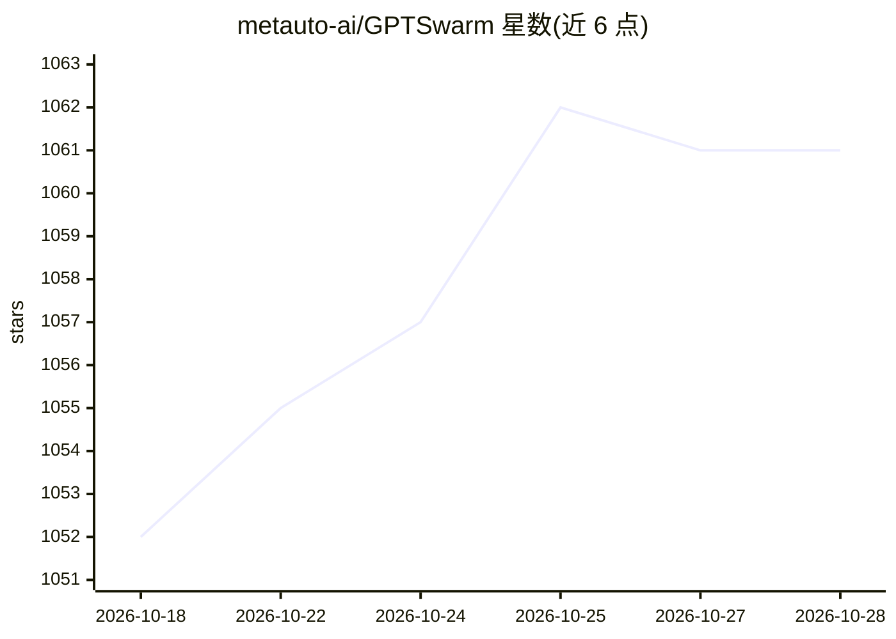

# metauto-ai/GPTSwarm

⭐ 1,062 · Python · MIT · 推送 2026-02-05 · [GitHub](https://github.com/metauto-ai/GPTSwarm) · [官网](https://gptswarm.org) · 组织维护 · 中文 README

**图结构构建与优化 LLM agent 群的开源框架**

由研究团队（ICML 2024 论文 GPTSwarm: Language Agents as Optimizable Graphs 作者）开发的 Python 库：将 LLM agent 表示为图，提供环境、图执行、LLM 后端接口、索引式记忆与优化器等模块，支持 agent 群的自组织与自我改进（如边优化做剪枝/创建）。可运行预定义 swarm 或自定义 agent，支持通过 LM Studio 做本地模型推理，需在 .env 配置 API key（OpenAI/搜索服务）。以 pip 与源码（poetry）方式安装，附 Colab 示例。

## 筛选速览

| 维度 | 判定 | 备注 |
|---|---|---|
| AI 角色 | `ai-ecosystem` | LLM/agent 周边工具 |
| 许可风险 | `permissive` | MIT |
| 部署形态 | `library` | 以包/库形式分发 |
| 模型依赖 | — | README 未给出锁定关系 |
| 硬件要求 | — | 无带数字的原话,不猜 |
| 安装摩擦 | `low` | 无编译、无系统依赖或容器化 |
| 成熟度 | — | 结构信号不足 |

## 能力要点

- 以图结构构建与执行 LLM agent 及 swarm 组合图
- 优化器模块对 agent 间连边做优化（剪枝/创建）
- 支持 LM Studio 本地模型推理
- 提供 IO/TOT 等预定义 swarm 与文件分析工具示例

## 适用场景

- 研究者复现或扩展可优化图结构的 agent 群实验
- 开发者以图方式编排多个 LLM agent 协作完成任务
- 在 GAIA 类任务上运行带工具调用的 swarm 示例

## 场景标签

`多智能体` `强化学习` · 领域:Agent 开发

## 证据(README 行号)

> L11: 🐝 **GPTSwarm is a graph-based framework for LLM-based agents, providing two high-level features:**
> L20: At a granular level, GPTSwarm is a library that includes the following components:
> L26: |**swarm.llm**|Interface for selecting LLM backends and calculating their operational costs|

## 星数曲线

2026-10-18 1,052 → 2026-10-28 1,061（+9）

---
*卡片 v1 · prompt 1.4 · 生成 2026-10-21 · 置信度 high · 依据 README sha `8e15b0928166` · [字段定义](../../DATASET.md)*
