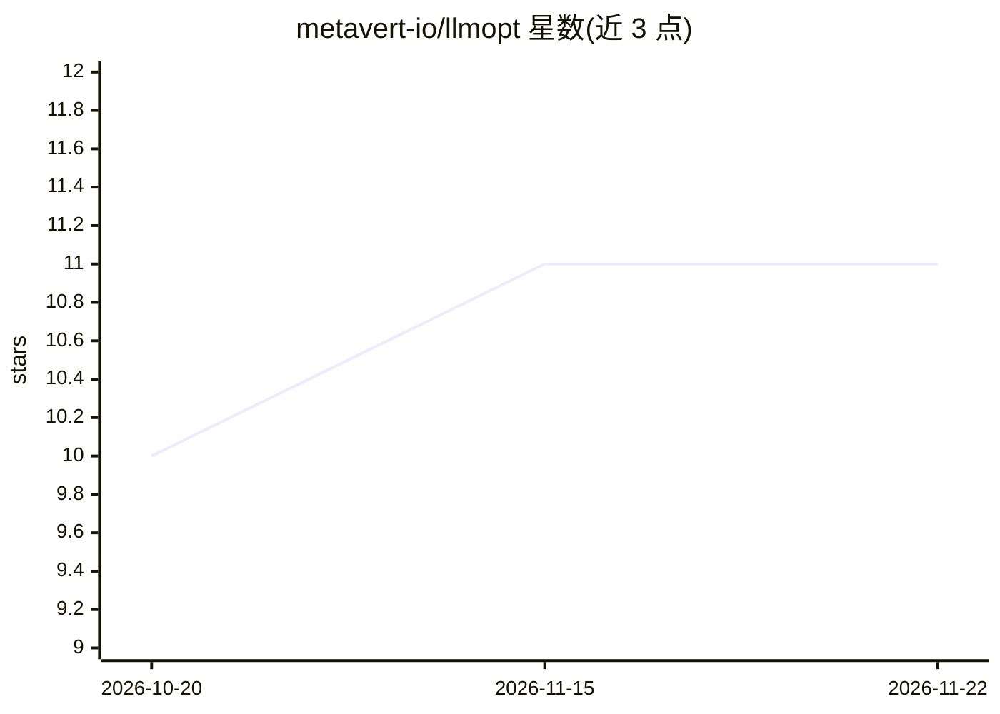

# metavert-io/llmopt

⭐ 11 · Go · MIT · 推送 2026-11-18 · [GitHub](https://github.com/metavert-io/llmopt) · 组织维护

**面向品牌方分析 LLM 与 AI 搜索如何引用推荐自己的平台**

Go 后端 + React 前端的平台，围绕品牌在生成式引擎中的可见性做六类分析：页面问答适配度、YouTube 视频权威度、Reddit 社区信号、AI 爬虫与搜索可见性、直接调用多家 LLM API 测试品牌提及/推荐率，并加权合成 0-100 的 AI Visibility Score 与行动项。方法基于公开研究并随研究更新改写建议。必需 Anthropic API key 与 MongoDB；SaaS 模式基于 LastSaaS 框架实现多租户与计费；提供 MCP Server 供 AI 助手读取分析数据。

## 筛选速览

| 维度 | 判定 | 备注 |
|---|---|---|
| AI 角色 | `ai-native` | 本体是模型或模型工具 |
| 许可风险 | `permissive` | MIT |
| 部署形态 | `library` | 以包/库形式分发 |
| 模型依赖 | locked-api |  |
| 硬件要求 | — | 无带数字的原话,不猜 |
| 安装摩擦 | `low` | 无编译、无系统依赖或容器化 |
| 成熟度 | — | 结构信号不足 |

## 能力要点

- 六类分析加权合成 AI Visibility Score（0-100）与优先级行动项
- 直接调用 Anthropic/OpenAI/Gemini/Grok API 测量品牌提及与推荐率
- 提供 MCP Server（Streamable HTTP + OAuth 2.1）供 AI 助手访问数据
- HTML/PDF 报告生成与公开分享链接

## 适用场景

- 评估我的网站在 AI 搜索中的可见性与爬虫可达性
- 比较同体量竞品在各 LLM 回答中的提及与推荐率
- 按研究支撑的优化建议改进页面内容结构

## 场景标签

`数据分析` · 领域:效率与自动化

## 证据(README 行号)

> L8: LLM Optimizer is an AI visibility intelligence platform. It analyzes how large language models and AI search engines
> L24: **LLM Knowledge Testing** — Directly queries multiple LLM providers (Anthropic, OpenAI, Gemini, Grok) through their
> L73: - **Anthropic API key** (required — used for site analysis, optimization scoring, and brand intelligence; analyses 

## 星数曲线

2026-10-20 10 → 2026-11-22 11（+1）

---
*卡片 v1 · prompt 1.4 · 生成 2026-11-18 · 置信度 high · 依据 README sha `caca40182b7e` · [字段定义](../../DATASET.md)*
