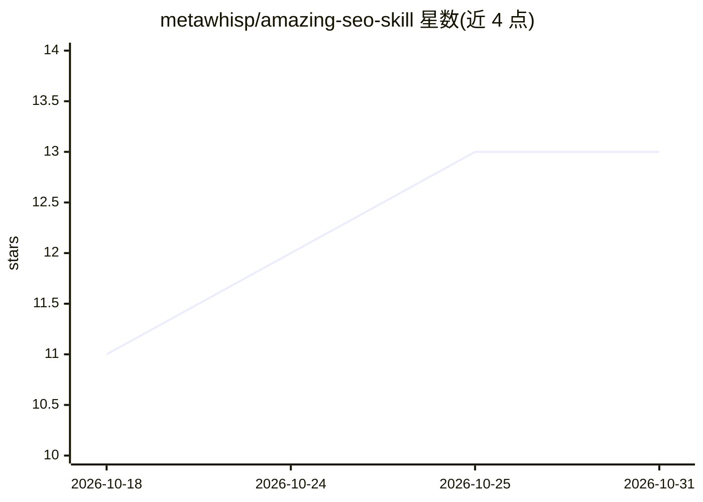

# metawhisp/amazing-seo-skill

⭐ 13 · Python · Apache-2.0 · 推送 2026-08-25 · [GitHub](https://github.com/metawhisp/amazing-seo-skill) · [官网](https://github.com/metawhisp/amazing-seo-skill) · 个人维护

**Claude Code 的 SEO/AEO/GEO 审计技能：站点体检+AI 引用检测**

以 Claude Code Skill 形式交付的网站审计工具集：约 29 个确定性 Python 检查器覆盖 robots/sitemap/安全头/断链/图片/Schema/hreflang/内链图/Core Web Vitals/CMS 检测等传统 SEO 项，叠加 AEO/GEO 层——通过多 LLM（ChatGPT、Claude、Perplexity、Grok、带 Google Search grounding 的 Gemini）实测目标查询是否引用域名，并输出 0-100 健康分与优先级行动清单。分轻量（仅推理）与全功能（4 层数据、需各 API key）两种模式，git clone 到 skills 目录即装，含 6 种行业模板与 SQLite 审计历史。

## 筛选速览

| 维度 | 判定 | 备注 |
|---|---|---|
| AI 角色 | `ai-ecosystem` | LLM/agent 周边工具 |
| 许可风险 | `permissive` | Apache-2.0 |
| 部署形态 | `None` |  |
| 模型依赖 | locked-api |  |
| 硬件要求 | — | 无带数字的原话,不猜 |
| 安装摩擦 | `low` | 无编译、无系统依赖或容器化 |
| 成熟度 | — | 结构信号不足 |

## 能力要点

- 29 个确定性检查器 + 6 个编排工具，输出 0-100 SEO 健康分
- 跨 5 个 LLM 表面的实时引用测试（AEO）与 AI 可见性评分
- 真实浏览器 Core Web Vitals、JS 渲染 diff、服务器日志分析
- 6 种行业模板（SaaS/电商/本地/出版/代理/通用）自动匹配

## 适用场景

- 新站或改版上线前做技术 SEO 与 AI 搜索可见性体检
- 查我的域名是否被 ChatGPT/Perplexity/Claude/Grok 引用
- 按季度跟踪 SEO 分数趋势与竞品关键词差距

## 场景标签

`网页抓取` · 领域:效率与自动化

## 证据(README 行号)

> L1: # Amazing SEO Skill — SEO + AEO + GEO Audit for Claude Code
> L104: git clone https://github.com/metawhisp/amazing-seo-skill.git \
> L211: Active development. v0.7 series — 29 deterministic checkers + 6 orchestrator

## 星数曲线

2026-10-18 11 → 2026-10-31 13（+2）

---
*卡片 v1 · prompt 1.4 · 生成 2026-10-31 · 置信度 high · 依据 README sha `07f4657cce74` · [字段定义](../../DATASET.md)*
