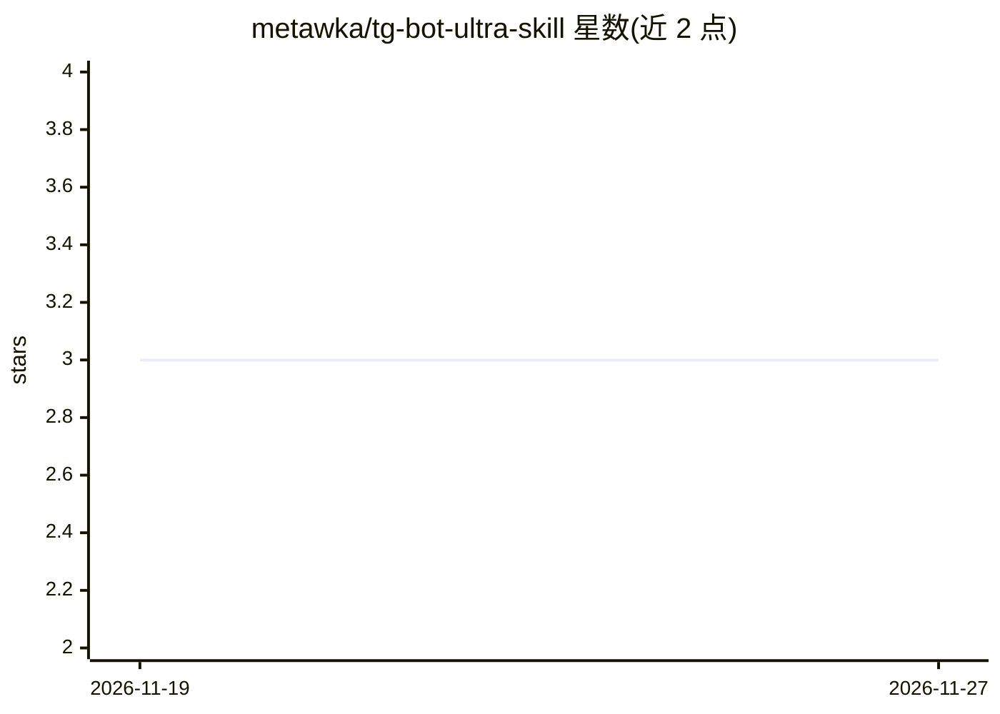

# metawka/tg-bot-ultra-skill

⭐ 3 · Python · MIT · 推送 2026-11-16 · [GitHub](https://github.com/metawka/tg-bot-ultra-skill) · 个人维护

**让 Claude Code 构建 Telegram 富消息机器人的技能与 BotFather MCP 服务器**

一个安装到 Claude Code 的技能包，用于构建基于 Bot API 10.x 的 Telegram 机器人：支持消息内表格、标题、按钮、彩色按钮、自定义 emoji、折叠块、幻灯片、地图和流式 AI 回答。写代码前先对机器人所有者进行结构化访谈（产品、数据、风格、每屏布局），并在机器人对话中发送实时预览。附带 botfather MCP 服务器，可在 @BotFather 中创建机器人、获取 token 写入 .env、遍历菜单，权限仅限 @BotFather 聊天，删除机器人与吊销 token 被禁止。通过 install.py 安装，需 Python 3.11+ 与 Claude Code。

## 筛选速览

| 维度 | 判定 | 备注 |
|---|---|---|
| AI 角色 | `ai-knowledge` | 知识聚合/清单类 |
| 许可风险 | `permissive` | MIT |
| 部署形态 | `desktop` | 安装包/桌面程序 |
| 模型依赖 | — | README 未给出锁定关系 |
| 硬件要求 | — | 无带数字的原话,不猜 |
| 安装摩擦 | `low` | 无编译、无系统依赖或容器化 |
| 成熟度 | — | 结构信号不足 |

## 能力要点

- Bot API 10.x 富消息参考：表格、折叠块、幻灯片、地图、流式 AI 回答
- 编码前的结构化访谈流程，实时预览发送到机器人聊天
- botfather MCP 服务器自动创建机器人并写入 token，权限受限
- 七套自定义 emoji 图标目录，按含义映射，含无 Premium 布局

## 适用场景

- 用自然语言让 Claude Code 搭建咖啡店点单、预订、会员积分类 Telegram 机器人
- 按设计规则构建商品卡片、目录、搜索、收据等机器人界面
- 通过 MCP 服务器自动完成 BotFather 注册与 token 获取

## 场景标签

`代码生成` · 领域:编码与开发

## 证据(README 行号)

> L3: A Claude Code skill for building Telegram bots on Bot API 10.x: rich messages with tables, headings and buttons insi
> L105: |`skills/telegram-bots/SKILL.md`|Workflow and rules|
> L106: |`skills/telegram-bots/references/`|Interview, design rules, rich message reference, icons, bot setup, hosting, ve

## 星数曲线

2026-11-19 3 → 2026-11-27 3（+0）

---
*卡片 v1 · prompt 1.4 · 生成 2026-11-21 · 置信度 mid · 依据 README sha `b79058dc037b` · [字段定义](../../DATASET.md)*
