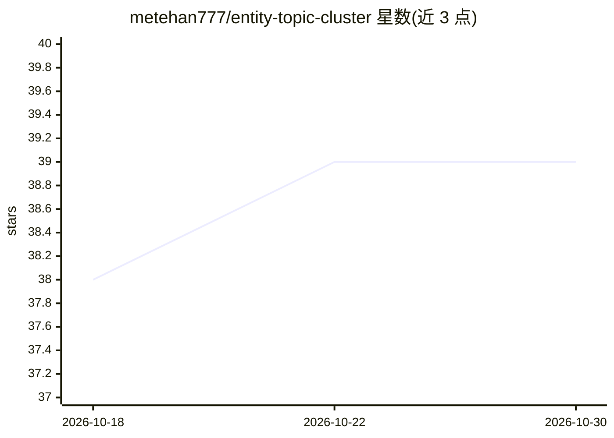

# metehan777/entity-topic-cluster

⭐ 39 · JavaScript · MIT · 推送 2026-02-26 · [GitHub](https://github.com/metehan777/entity-topic-cluster) · 个人维护

**浏览器内运行的开源实体主题聚类与知识图谱可视化工具**

100% 客户端网页工具：用户粘贴网站标题与描述，浏览器内通过 Transformers.js 运行 NER 模型（distilbert 多语言）提取人名/机构/地点实体，用 all-MiniLM-L6-v2 计算 384 维句向量，经 Wikidata API 解析为 QID，再以 2D 力导向图、3D t-SNE 散点和层级 treemap 三种模式可视化。数据不离开本机（仅 Wikidata 公开查询）。前端零构建、全 CDN 加载；另含可选 Cloudflare Worker 提供 /resolve REST API。面向 SEO 从业者做主题聚类、内容差距与自相蚕食检测。

## 筛选速览

| 维度 | 判定 | 备注 |
|---|---|---|
| AI 角色 | `ai-native` | 本体是模型或模型工具 |
| 许可风险 | `permissive` | MIT |
| 部署形态 | `library` | 以包/库形式分发 |
| 模型依赖 | — | README 未给出锁定关系 |
| 硬件要求 | — | 无带数字的原话,不猜 |
| 安装摩擦 | `low` | 无编译、无系统依赖或容器化 |
| 成熟度 | — | 结构信号不足 |

## 能力要点

- 浏览器内运行 NER 与句向量模型（Transformers.js），无需服务器与 API key
- 实体解析到 Wikidata QID 并以三种模式可视化（2D 图/3D t-SNE/treemap）
- 前端零构建步骤，全部库经 CDN 加载
- 附带可选 Cloudflare Worker 提供 /resolve 实体解析 REST API

## 适用场景

- 按共享实体对大量页面做主题聚类
- 发现站内互链机会与高相似度（>0.85）自相蚕食页面
- 以知识图谱实体规划站点内容架构

## 场景标签

`知识图谱` · 领域:知识与检索

## 证据(README 行号)

> L10: 2. **ML models run locally** in your browser to extract named entities (people, companies, locations) and compute s
> L30: |NER|`Xenova/distilbert-base-multilingual-cased-ner-hrl` via Transformers.js|Extract person / org / location entiti

## 星数曲线

2026-10-18 38 → 2026-10-30 39（+1）

---
*卡片 v1 · prompt 1.4 · 生成 2026-10-25 · 置信度 mid · 依据 README sha `567339d2791d` · [字段定义](../../DATASET.md)*
