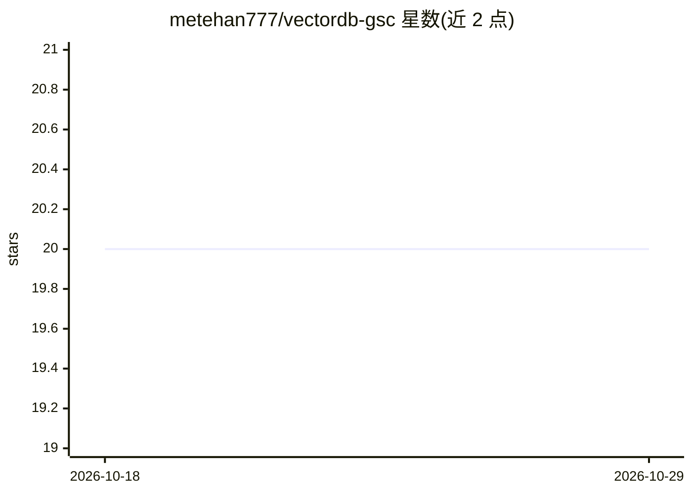

# metehan777/vectordb-gsc

⭐ 20 · Python · 推送 2026-03-18 · [GitHub](https://github.com/metehan777/vectordb-gsc) · [官网](https://metehan.ai/blog/i-turned-16-months-of-google-search-console-data-into-a-vector-database-heres-what-i-learned/) · 个人维护

**把 Google Search Console 数据转为本地向量库并用 AI 做 SEO 分析的 CLI 工具**

面向网站所有者/SEO 从业者的 Python CLI 工具：从 GSC API 抽取近 16 个月搜索表现数据，聚合成查询-页面对文档并计算趋势，用 Gemini 嵌入（MRL 768 维）写入本地 ChromaDB，再通过 RAG 由 Gemini/Grok/Claude 三选一做自然语言分析；可选接入 Parallel.ai 抓取自身与竞对页面做内容差距审计。README 自述局限：数值精确过滤不如 SQL，数据需 refresh 才更新。需要 GCP 服务账号与各 API key。

## 筛选速览

| 维度 | 判定 | 备注 |
|---|---|---|
| AI 角色 | `ai-native` | 本体是模型或模型工具 |
| 许可风险 | `none` | — |
| 部署形态 | `library` | 以包/库形式分发 |
| 模型依赖 | locked-api |  |
| 硬件要求 | — | 无带数字的原话,不猜 |
| 安装摩擦 | `low` | 无编译、无系统依赖或容器化 |
| 成熟度 | — | 结构信号不足 |

## 能力要点

- GSC 数据 → Gemini 嵌入 → 本地 ChromaDB 的完整管道
- 三 LLM 提供方可选（Gemini/Grok/Claude），Grok 因 2M 上下文送入 5 倍文档
- Parallel.ai 页面审计与竞对内容对比
- 16 个月历史数据本地存储，无 API 配额限制

## 适用场景

- 用自然语言查询搜索表现并发现主题趋势
- 对单页做内容差距审计（自身 vs 竞对）
- 16 个月历史数据的批量语义分析

## 场景标签

`RAG` `数据分析` · 领域:效率与自动化

## 证据(README 行号)

> L16: 2. **Embeds** queries, pages, and metrics into a local ChromaDB vector database using Gemini embeddings
> L17: 3. **Analyzes** your data using AI with semantic retrieval (RAG) — pick from 3 providers

## 星数曲线

2026-10-18 20 → 2026-10-29 20（+0）

---
*卡片 v1 · prompt 1.4 · 生成 2026-10-28 · 置信度 mid · 依据 README sha `1aadb8819a65` · [字段定义](../../DATASET.md)*
