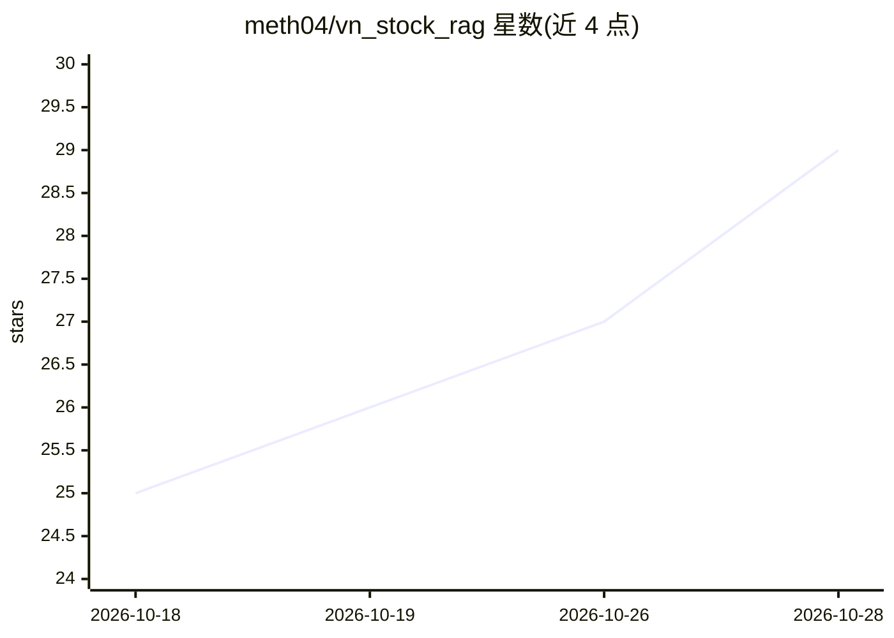

# meth04/vn_stock_rag

⭐ 29 · Python · NOASSERTION · 推送 2026-03-28 · [GitHub](https://github.com/meth04/vn_stock_rag) · [官网](https://github.com/meth04/TradingAgent-VN) · 个人维护

**越南股市多 Agent RAG 分析平台，生成投资研究报告**

基于 CrewAI 与 Google Gemini 的越南证券分析系统：5 个专职 Agent（市场情报、技术分析、基本面、竞品分析、报告编辑）协作，完成实时数据采集、多维分析与标准化研报输出。RAG 部分用 MistralOCR 数字化扫描版财报 PDF、Gemini Embeddings 向量化并强制引用来源；另含交互 Chatbot、每日 07:00 定时邮件推送 PDF 报告。以 Docker Compose 部署，需 Google/Serper/Mistral 三方 API Key，提供 LLM-as-a-Judge 与 Ragas 组件评测及 Streamlit 仪表盘。README 声明仅为分析辅助工具而非投资建议。

## 筛选速览

| 维度 | 判定 | 备注 |
|---|---|---|
| AI 角色 | `ai-native` | 本体是模型或模型工具 |
| 许可风险 | `none` | NOASSERTION |
| 部署形态 | `self-host` | docker 或自建部署 |
| 模型依赖 | — | README 未给出锁定关系 |
| 硬件要求 | — | 无带数字的原话,不猜 |
| 安装摩擦 | `low` | 无编译、无系统依赖或容器化 |
| 成熟度 | — | 结构信号不足 |

## 能力要点

- CrewAI 编排 5 个专职分析 Agent 协同产出研报
- MistralOCR 数字化扫描版财报 + Gemini Embeddings 向量检索，回答强制引用来源
- 每日 07:00 定时运行并邮件推送 PDF 报告
- LLM-as-a-Judge 与 Ragas 双层质量评测

## 适用场景

- 让 AI 自动扫描新闻、计算技术指标并生成某只越南股票的完整分析报告
- 订阅每日自动推送的持仓股 PDF 研报邮件
- 对扫描版越南财报 PDF 做提问式检索查询

## 场景标签

`多智能体` `金融量化` `文档问答` `聊天机器人` · 领域:Agent 开发

## 证据(README 行号)

> L9: **VnStock RAG** là giải pháp công nghệ tài chính tự động hóa quy trình phân tích cổ phiếu. Thay vì phụ thuộc vào việ
> L41: Dự án được xây dựng trên nền tảng **CrewAI**, quản lý luồng làm việc của 5 Agents chuyên biệt:
> L65: * **LLM Provider:** Google Gemini (Flash 2.5 & Pro).

## 星数曲线

2026-10-18 25 → 2026-10-28 29（+4）

---
*卡片 v1 · prompt 1.4 · 生成 2026-10-26 · 置信度 high · 依据 README sha `9796c087bd18` · [字段定义](../../DATASET.md)*
