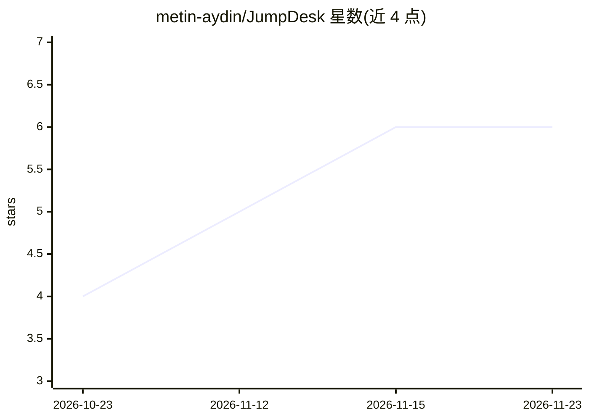

# metin-aydin/JumpDesk

⭐ 6 · TypeScript · MIT · 推送 2026-11-14 · [GitHub](https://github.com/metin-aydin/JumpDesk) · 个人维护

**面向 JumpServer 运维的 AI 桌面客户端：SSH/RDP/SFTP 加命令助手**

基于 Electron 的跨平台 JumpServer 桌面客户端，提供标签页与分屏的 SSH/Telnet 终端、经 Guacamole 网关的 RDP、SFTP 文件管理、代码片段、日志高亮与告警规则，支持 JumpServer v4 社区版登录（LDAP/MFA/SSO）。内置可选 AI 助手：将自然语言转命令、解释选中的报错与告警、生成片段和规则，接入 Anthropic/OpenAI/Gemini/Azure 及 OpenAI 兼容本地服务；命令经本地规则标记危险并需确认，API key 经系统 keyring 加密。提供 Linux/Windows/macOS 安装包与应用内更新。

## 筛选速览

| 维度 | 判定 | 备注 |
|---|---|---|
| AI 角色 | `ai-enhanced` | 去掉 AI 部分产品仍成立 |
| 许可风险 | `permissive` | MIT |
| 部署形态 | `desktop` | 安装包/桌面程序 |
| 模型依赖 | local-ok | 支持本地模型 |
| 硬件要求 | — | 无带数字的原话,不猜 |
| 安装摩擦 | `low` | 无编译、无系统依赖或容器化 |
| 成熟度 | — | 结构信号不足 |

## 能力要点

- 自然语言转命令与报错/告警解释，支持多 provider 及本地模型
- 本地规则检测危险命令，提示词将终端文本视为不可信数据
- AI 生成的告警与高亮规则可对样例行即时测试
- AI 功能逐项开关，发送前展示并确认终端文本

## 适用场景

- 给 JumpServer 资产一个带分屏终端和文件管理的桌面入口
- 让 AI 把自然语言转成排查命令并解释报错
- 用描述生成日志告警与高亮规则
- 通过 OpenAI 兼容本地模型在离线环境使用 AI 功能

## 场景标签

`AI 助手` · 领域:对话与助手

## 证据(README 行号)

> L11: JumpDesk turns your JumpServer assets into an AI-assisted desktop workspace: browse the server tree, open SSH, SFTP
> L74: - **AI assistant (optional)**: commands from plain language, explanations of selected output and alarms, AI-written

## 星数曲线

2026-10-23 4 → 2026-11-23 6（+2）

---
*卡片 v1 · prompt 1.4 · 生成 2026-11-20 · 置信度 high · 依据 README sha `aac44c967c6a` · [字段定义](../../DATASET.md)*
