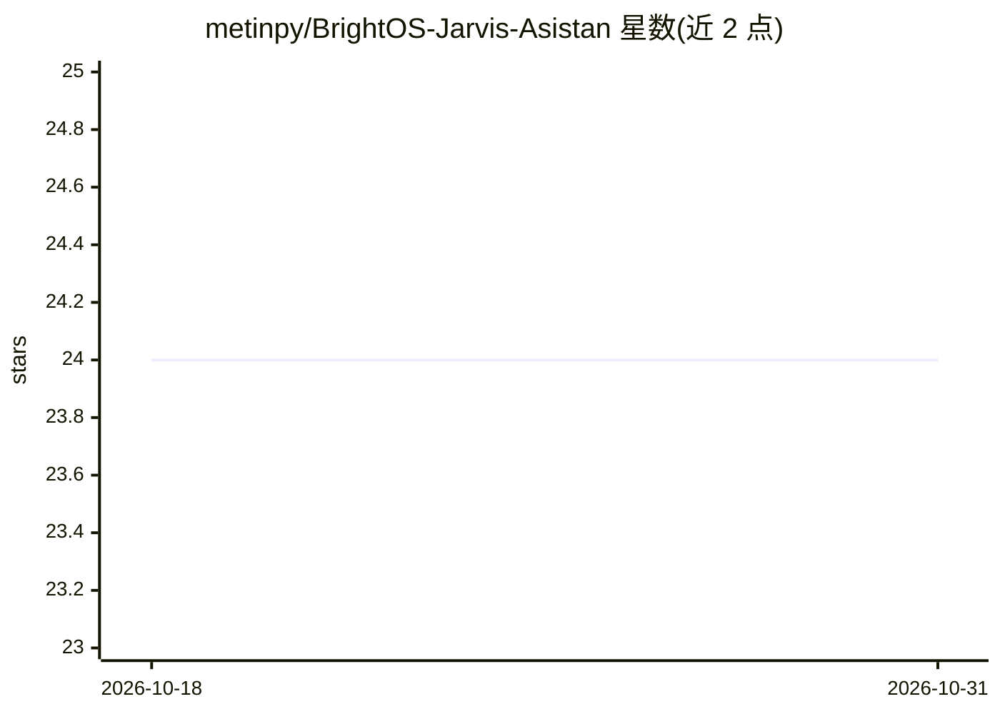

# metinpy/BrightOS-Jarvis-Asistan

⭐ 24 · Python · 推送 2026-03-17 · [GitHub](https://github.com/metinpy/BrightOS-Jarvis-Asistan) · 个人维护

**基于 BrightOS 的语音 AI 个人助理：控制系统与应用执行任务**

个人 AI 助理应用，面向终端用户：通过语音与视觉交互接收指令，将复杂目标拆解为执行计划，并调用模块套件控制系统——启动应用、控制浏览器、执行 shell 命令、操作鼠标键盘、管理本地文件等。采用本地向量存储做长期记忆，加密层管理 API 密钥。安装需 Python 3.10+ 与麦克风/扬声器，运行 installer.bat 与 run.bat，首次启动需输入 Master API Key。

## 筛选速览

| 维度 | 判定 | 备注 |
|---|---|---|
| AI 角色 | `ai-native` | 本体是模型或模型工具 |
| 许可风险 | `permissive` | — |
| 部署形态 | `None` |  |
| 模型依赖 | — | README 未给出锁定关系 |
| 硬件要求 | — | 无带数字的原话,不猜 |
| 安装摩擦 | `low` | 无编译、无系统依赖或容器化 |
| 成熟度 | — | 结构信号不足 |

## 能力要点

- 语音/视觉实时交互与自主任务规划（central_nerve 规划执行）
- 10 个执行模块：应用启动、浏览器控制、shell 命令、鼠标键盘操控等
- 本地向量存储的长期记忆（neural_store）
- 加密层管理 API 与凭证（security_vault）

## 适用场景

- 用语音指令让 AI 代为打开应用、操作浏览器与文件
- 把复杂目标交给 AI 拆解并自动执行
- 让 AI 辅助编码调试或从描述生成项目

## 场景标签

`AI 助手` `语音 Agent` `GUI 自动化` · 领域:效率与自动化

## 证据(README 行号)

> L10: - **Neural Hub (JARVIS):** Real-time voice and visual interaction with advanced reasoning.
> L29: |`open_app`|Launches system applications seamlessly.|

## 星数曲线

2026-10-18 24 → 2026-10-31 24（+0）

---
*卡片 v1 · prompt 1.4 · 生成 2026-10-27 · 置信度 high · 依据 README sha `1e3c4be5168b` · [字段定义](../../DATASET.md)*
