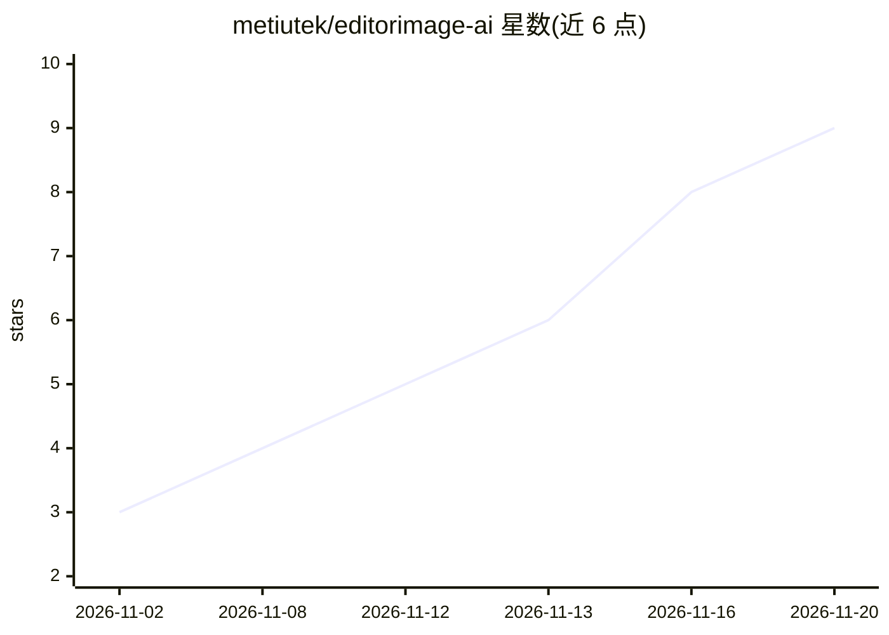

# metiutek/editorimage-ai

⭐ 9 · Python · MIT · 推送 2026-10-16 · [GitHub](https://github.com/metiutek/editorimage-ai) · 个人维护

**用自然语言驱动的开源 AI 图像编辑器，供个人与 agent 使用**

一个 MIT 许可的分层栅格图像编辑器，提供图层、蒙版、混合模式、克隆图章等常规编辑功能，并支持生成式填充、扩图、图生图、文生图、背景移除与放大。编辑器本身即 MCP 服务器，暴露 62 个与 UI 按钮相同的工具，可由 Claude Code、Cursor 等任何 MCP 客户端驱动编辑；本地功能含背景/物体移除（CPU 可离线），在线生成需用户自带 OpenAI、Gemini、Stability、Replicate、OpenRouter 等 API key 或本地运行 ComfyUI。文档明确不支持 CMYK、16-bit 与 PSD。

## 筛选速览

| 维度 | 判定 | 备注 |
|---|---|---|
| AI 角色 | `ai-native` | 本体是模型或模型工具 |
| 许可风险 | `permissive` | MIT |
| 部署形态 | `None` |  |
| 模型依赖 | local-ok | 支持本地模型 |
| 硬件要求 | — | 无带数字的原话,不猜 |
| 安装摩擦 | `low` | 无编译、无系统依赖或容器化 |
| 成熟度 | — | 结构信号不足 |

## 能力要点

- 62 个 MCP 工具与 UI 按钮调用同一套操作，agent 与鼠标可混用编辑
- 非破坏性编辑：滤镜、AI 抠图、物体移除均以图层效果/蒙版呈现，可逐步撤销
- 本地背景移除（rembg/ONNX）与物体移除可在无 GPU 的 CPU 上离线运行
- 文档为 JSON 文件，预览与导出出自同一渲染函数

## 适用场景

- 我用文字描述要求，让 AI agent 在真实图层上完成修图
- 本地离线抠图与物体移除，无需上传图片或 GPU
- 为 Claude Code / Cursor 接入图像编辑 MCP 工具
- 免费替代方案处理图层、蒙版、调色等常规修图任务

## 场景标签

`图像生成` `图像视频处理` · 领域:内容生成

## 证据(README 行号)

> L3:  pedit — open-source AI image editor you can drive with words (MCP)
> L5:  A free, layered photo editor — a Photoshop / GIMP alternative — that an AI agent can use for you.
> L10:  62 MCP tools

## 星数曲线

2026-11-02 3 → 2026-11-20 9（+6）

---
*卡片 v1 · prompt 1.4 · 生成 2026-11-20 · 置信度 high · 依据 README sha `a0bd77dab9d5` · [字段定义](../../DATASET.md)*
