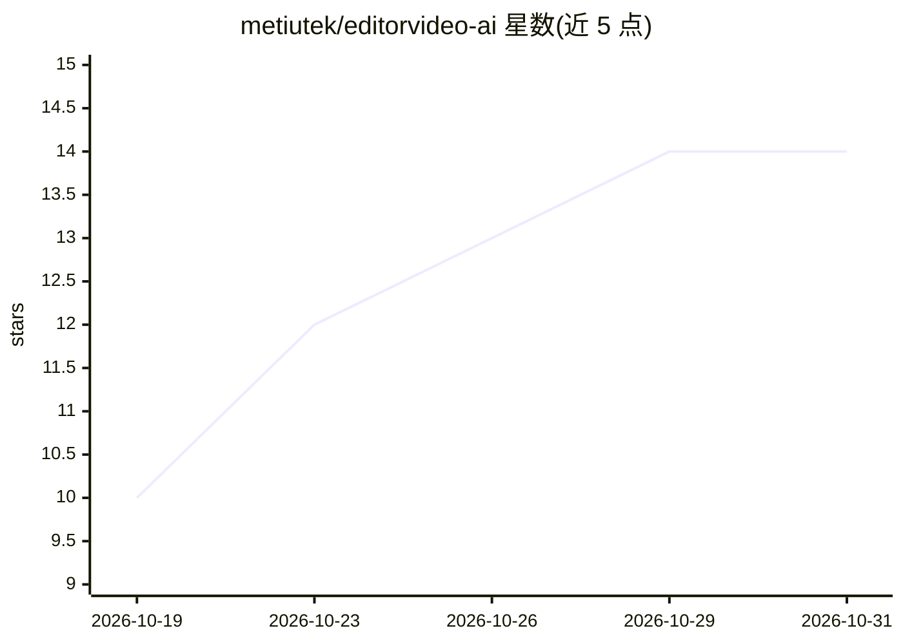

# metiutek/editorvideo-ai

⭐ 14 · Python · MIT · 推送 2026-10-29 · [GitHub](https://github.com/metiutek/editorvideo-ai) · [官网](https://pypi.org/project/vedit-mcp/) · 个人维护

**可由 AI 代操作的本地非线性视频编辑器（MCP 工具集）**

vedit 是一个本地运行的非线性视频编辑器：时间线、多轨道、剪辑、变速、调色、转场、导出与发布，渲染基于确定性的 ffmpeg 引擎。特色在于 114 个 MCP 工具与界面按钮调用同一套操作，AI agent（Claude Code/Cursor/Codex 或内置助手）可代为剪辑并预览真实渲染帧，用户随时可用鼠标修正并 Ctrl+Z 撤销；项目即 JSON 文档。经 PyPI 安装，ffmpeg 由命令下载；界面仅英文，代码注释为意大利语。

## 筛选速览

| 维度 | 判定 | 备注 |
|---|---|---|
| AI 角色 | `ai-enhanced` | 去掉 AI 部分产品仍成立 |
| 许可风险 | `permissive` | MIT |
| 部署形态 | `library` | 以包/库形式分发 |
| 模型依赖 | locked-api |  |
| 硬件要求 | — | 无带数字的原话,不猜 |
| 安装摩擦 | `medium` | 含编译或系统依赖之一 |
| 成熟度 | — | 结构信号不足 |

## 能力要点

- 114 个 MCP 工具与 UI 按钮共用同一套剪辑操作
- preview_frame/preview_grid 返回真实渲染帧供 agent 自查
- music_beats 返回 BPM/节拍/能量曲线，plan_edit 拆分并评分镜头
- 本地确定性渲染，项目为 JSON 文档，可 diff 与版本控制

## 适用场景

- 用自然语言让 agent 完成去静音、卡点剪辑、字幕烧录等重复劳动
- 在 Claude Code/Cursor 等编码 agent 中直接调用视频剪辑能力
- 在脚本/流水线中以 CLI 与 JSON 项目做自动化剪辑

## 场景标签

`图像视频处理` · 领域:感知与多模态

## 证据(README 行号)

> L79: vedit is a video editor. The ordinary kind: a timeline, video and audio tracks, clips you
> L82: The difference is that **everything you can do with the mouse, an AI can also do on command** —
> L123: |**An agent can actually edit**|114 MCP tools that are the *same* operations as the buttons: cut, split, speed, ke

## 星数曲线

2026-10-19 10 → 2026-10-31 14（+4）

---
*卡片 v1 · prompt 1.4 · 生成 2026-10-31 · 置信度 high · 依据 README sha `c82e948d850b` · [字段定义](../../DATASET.md)*
