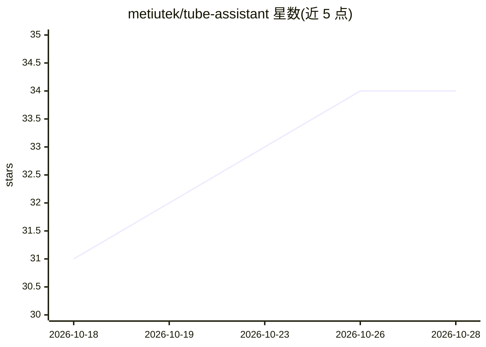

# metiutek/tube-assistant

⭐ 34 · Python · MIT · 推送 2026-10-22 · [GitHub](https://github.com/metiutek/tube-assistant) · 个人维护

**全自动运营 YouTube 频道的 AI agent，Telegram 操控**

面向内容创作者的开源自动化 agent：每日按设定时间读取频道分析数据、用 LLM 生成脚本、Edge TTS 合成配音、从 Pexels 下载素材（或经 Replicate/fal.ai/Luma 生成片段）、FFmpeg 剪辑、AI 生成缩略图并上传 YouTube，全程通过 Telegram 命令或自然语言控制。支持 15 个 LLM 提供商（OpenRouter/Ollama 等默认免费），提供 pip/uv 安装与 CLI/TUI，需 Python 3.11+、FFmpeg、Google/Telegram/Pexels API key。

## 筛选速览

| 维度 | 判定 | 备注 |
|---|---|---|
| AI 角色 | `ai-native` | 本体是模型或模型工具 |
| 许可风险 | `permissive` | MIT |
| 部署形态 | `library` | 以包/库形式分发 |
| 模型依赖 | local-ok | 支持本地模型 |
| 硬件要求 | — | 无带数字的原话,不猜 |
| 安装摩擦 | `medium` | 含编译或系统依赖之一 |
| 成熟度 | — | 结构信号不足 |

## 能力要点

- 从选题到发布全流程自动化，含分析数据驱动的选题
- 支持 15 个 AI 提供商，含本地 Ollama 与免费档 OpenRouter/Groq/Gemini
- Telegram 实时控制：命令队列、立即发布、查看统计
- 管线断点恢复，视频生成可选混合模式并设支出上限

## 适用场景

- 让 AI 每天自动产出并发布无真人出镜视频
- 通过 Telegram 远程控制频道内容排期与选题
- 零成本起步运营 YouTube 频道（免费 API 组合）

## 场景标签

`视频生成` · 领域:内容生成

## 证据(README 行号)

> L17: **TubeAssistant** is an open-source AI agent that automates your entire YouTube workflow. It generates scripts with
> L69: Analytics → Strategy → AI Script → TTS Voice → Stock Clips → Montage → AI Thumbnail → Upload
> L76: 3. **Writes a full script** using an LLM (OpenRouter, Ollama Cloud, or local)

## 星数曲线

2026-10-18 31 → 2026-10-28 34（+3）

---
*卡片 v1 · prompt 1.4 · 生成 2026-10-25 · 置信度 high · 依据 README sha `55521300f99f` · [字段定义](../../DATASET.md)*
