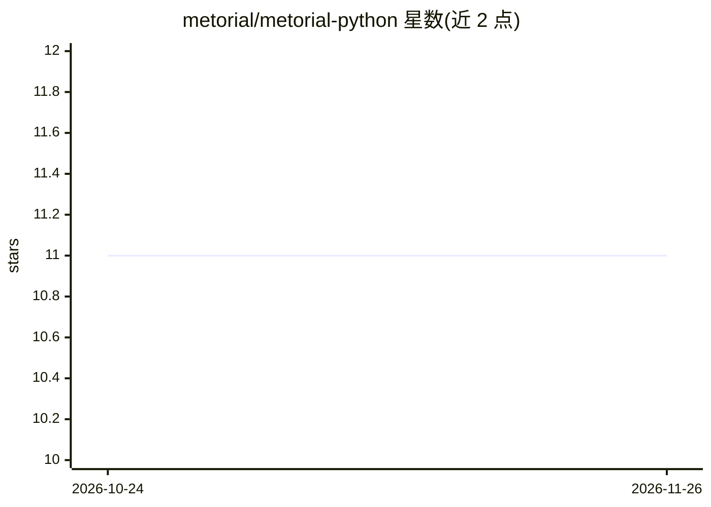

# metorial/metorial-python

⭐ 11 · Python · MIT · 推送 2026-11-23 · [GitHub](https://github.com/metorial/metorial-python) · [官网](https://metorial.com) · 组织维护

**给 AI agent 接入 MCP 工具的 Python SDK**

Metorial 平台的官方 Python SDK：通过 MCP 协议让 AI agent 使用 Slack、GitHub、SAP 等 MCP 工具，无需自行管理服务器与认证流程。核心机制包括按 LLM 供应商格式化 MCP 工具（openai/anthropic/google/mistral/deepseek 等 provider 参数）、9 个 agent 框架的工具转换辅助函数（AutoGen/CrewAI/LangChain 等）、多种 MCP 提供商认证方式（dashboard 配置、auth config、inline 凭据、OAuth setup session）与文件上传（>100 MB 走预签名 URL）。使用需注册 Metorial 账号获取 API key。

## 筛选速览

| 维度 | 判定 | 备注 |
|---|---|---|
| AI 角色 | `ai-ecosystem` | LLM/agent 周边工具 |
| 许可风险 | `permissive` | MIT |
| 部署形态 | `library` | 以包/库形式分发 |
| 模型依赖 | locked-api |  |
| 硬件要求 | — | 无带数字的原话,不猜 |
| 安装摩擦 | `low` | 无编译、无系统依赖或容器化 |
| 成熟度 | — | 结构信号不足 |

## 能力要点

- 按 provider 参数为各 LLM 供应商格式化 MCP 工具
- 9 个 agent 框架的工具格式转换集成函数
- 四种 MCP 提供商认证方式与 session 模板
- 文件上传支持路径/字节/文件对象，>100 MB 走预签名 URL

## 适用场景

- 给我的 agent 接入 Slack、GitHub、SAP 等 MCP 工具
- 让 LangChain/AutoGen 等框架的 agent 直接调用外部工具
- 为每终端用户单独走 OAuth 认证的 SaaS 场景接入工具

## 场景标签

`Agent 框架` · 领域:Agent 开发

## 证据(README 行号)

> L3: The official Python SDK for Metorial. Give your AI agents access to tools like Slack, GitHub, SAP, and hundreds more
> L31: This SDK formats MCP tools for each LLM provider. Pass the `provider` parameter to get tools in the right format.
> L45: For popular agent frameworks, we provide helper functions that convert tools to the framework's native format:

## 星数曲线

2026-10-24 11 → 2026-11-26 11（+0）

---
*卡片 v1 · prompt 1.4 · 生成 2026-11-18 · 置信度 high · 依据 README sha `06da0f8f70d9` · [字段定义](../../DATASET.md)*
