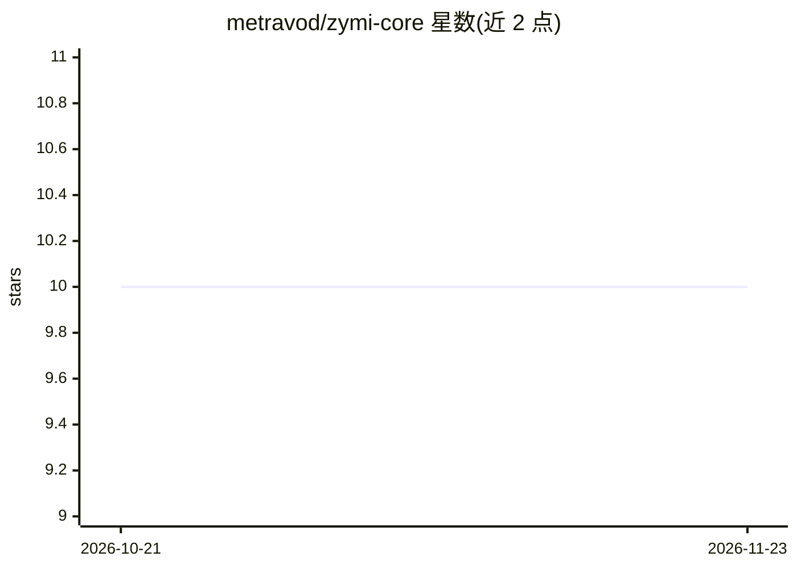

# metravod/zymi-core

⭐ 10 · Rust · MIT · 推送 2026-10-05 · [GitHub](https://github.com/metravod/zymi-core) · 个人维护

**面向 agent 的可审计 MCP 后端：把流程固化为 YAML 管线**

zymi-core 将 agent 试错收敛出的操作流程编译为声明式 YAML 管线（DAG 步骤：确定性工具、LLM agent 步、ask 步），脱离 agent 也可用 `zymi run` 执行；经 `zymi mcp serve` 可将管线作为 MCP 工具暴露给 Claude Code、Cursor 等宿主。每次状态变更写入哈希链事件日志，支持重放、分叉续跑、TUI 观测；危险步骤发布 intention 并经策略/审批门控。提供 uv 安装、Python 嵌入 API 与 CLI，长任务可经连接器以事件驱动运行。

## 筛选速览

| 维度 | 判定 | 备注 |
|---|---|---|
| AI 角色 | `ai-ecosystem` | LLM/agent 周边工具 |
| 许可风险 | `permissive` | MIT |
| 部署形态 | `library` | 以包/库形式分发 |
| 模型依赖 | — | README 未给出锁定关系 |
| 硬件要求 | — | 无带数字的原话,不猜 |
| 安装摩擦 | `low` | 无编译、无系统依赖或容器化 |
| 成熟度 | — | 结构信号不足 |

## 能力要点

- 声明式 YAML 管线：工具步、agent 步、ask 步组成 DAG，可并行执行
- 事件溯源：哈希链事件日志支持重放、fork-resume、TUI 观测与完整性校验
- 审批门控：步骤发布 intention，经 terminal/http/telegram/mcp_elicitation 通道等人审批
- 作为 MCP 服务器把管线暴露为工具，审批以 approve/deny 表单呈现在调用方 UI

## 适用场景

- 把 coding agent 反复推导出的运维流程固化为可复用管线
- 通过 MCP 让 agent 调用已固化的流程而非每次重新推导
- 需要人工审批高风险操作（shell、文件写入、HTTP）的自动化
- 审计与重试历史运行，从任意步骤分叉续跑

## 场景标签

`工作流自动化` · 领域:效率与自动化

## 证据(README 行号)

> L5:  Compile what your agent figured out into pipelines that run without it — declarative, event-sourced, approval-gated
> L22: - **Your agent still uses it** — as one MCP tool, via `zymi mcp serve`, instead of re-deriving the procedure every 
> L107: `zymi mcp serve` exposes pipelines as MCP tools over stdio to Claude Code, Claude Desktop, Cursor, or any framewor

## 星数曲线

2026-10-21 10 → 2026-11-23 10（+0）

---
*卡片 v1 · prompt 1.4 · 生成 2026-11-19 · 置信度 high · 依据 README sha `c54f20812c60` · [字段定义](../../DATASET.md)*
