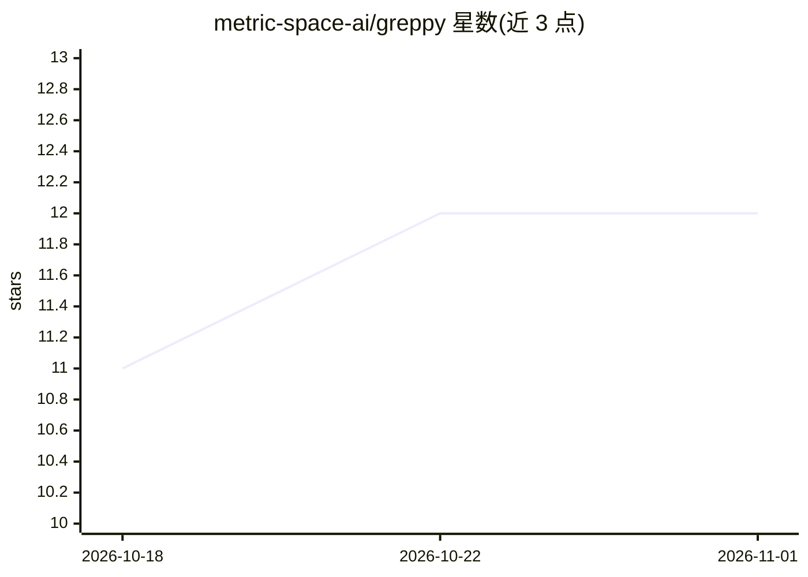

# metric-space-ai/greppy

⭐ 12 · Rust · Apache-2.0 · 推送 2026-10-23 · [GitHub](https://github.com/metric-space-ai/greppy) · 组织维护

**给编码 agent 的本地代码导航与编辑工具（含 grep 透传）**

面向编码 agent 的本地代码导航 CLI：提供确定性符号图、语义搜索、函数简报、带证书的编辑与 CoW 工作区；普通 grep/ripgrep 调用逐字节透传给真实系统命令。索引、嵌入与摘要全部由本地内嵌模型（EmbeddingGemma 300M 与 Qwen3.5 0.8B 微调）离线计算，无遥测、无账号。集成方式仅为复制 AGENTS.md 提示词，兼容可执行 shell 命令的任意 agent。单一 Rust 二进制，提供 macOS/Linux 预构建包；产品构建要求 Metal 或 CUDA 后端，Windows 0.4.1 无发布包。

## 筛选速览

| 维度 | 判定 | 备注 |
|---|---|---|
| AI 角色 | `ai-ecosystem` | LLM/agent 周边工具 |
| 许可风险 | `permissive` | Apache-2.0 |
| 部署形态 | `desktop` | 安装包/桌面程序 |
| 模型依赖 | — | README 未给出锁定关系 |
| 硬件要求 | — | 无带数字的原话,不猜 |
| 安装摩擦 | `medium` | 含编译或系统依赖之一 |
| 成熟度 | `idea` | |

## 能力要点

- 确定性符号图 + 语义搜索 + 函数简报，全部本地离线运行
- grep/ripgrep 调用逐字节透传真实命令，不做静默替换
- 集成仅需复制一个 AGENTS.md 提示词文件，无需 MCP/API key
- 内嵌 EmbeddingGemma(300M) 与 Qwen3.5(0.8B) 微调两个模型

## 适用场景

- 让编码 agent 用更少的搜索轮次回答谁调用/改哪会破坏等问题
- 在离线或隔离网络环境中为 agent 提供代码导航
- 保持既有 grep 工作流不变的同时获得结构化代码查询

## 场景标签

`语义搜索` · 领域:知识与检索

## 证据(README 行号)

> L5: **Local code navigation, transactional editing, portable CoW workspaces, and a native browser tool for coding agents
> L34: Code navigation runs entirely on your machine: index, symbol graph, embeddings,
> L181: server, no per-agent config, no API keys. Works in any agent that can run

## 星数曲线

2026-10-18 11 → 2026-11-01 12（+1）

---
*卡片 v1 · prompt 1.4 · 生成 2026-11-01 · 置信度 high · 依据 README sha `aeddeb59bce3` · [字段定义](../../DATASET.md)*
