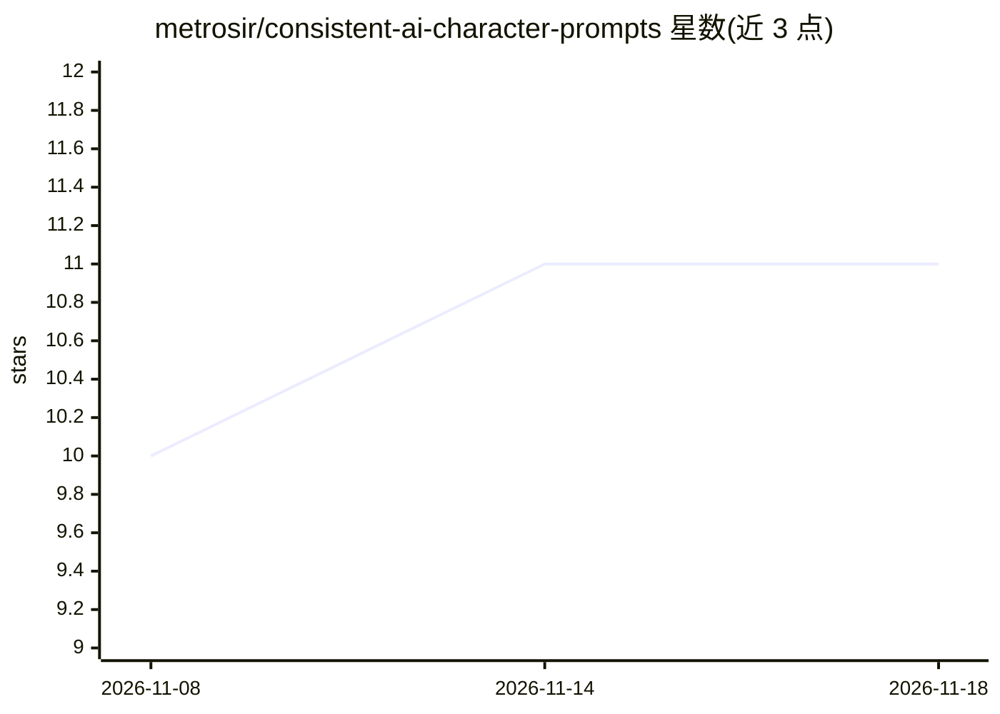

# metrosir/consistent-ai-character-prompts

⭐ 11 · 推送 2026-06-24 · [GitHub](https://github.com/metrosir/consistent-ai-character-prompts) · [官网](https://www.picovix.app/) · 个人维护

**为 AI 虚拟网红提供保持角色一致性的提示词库**

开源提示词库，收录 21 个场景提示词（咖啡馆、海滩、街头等）与 14 个 2026 流行美学风格提示词，均为人像 9:16 构图。使用方式是将场景提示词与角色专属 LoRA 触发词或参考图组合，以在不同场景、服装、光线下保持同一角色身份。附带一致性技巧（触发词置首、固定身份描述、中景构图）与 Midjourney --cref/--sref、seed 等延伸阅读链接，并提供 Picovix 在线演示。MIT 许可，接受新场景提示词的 PR。

## 筛选速览

| 维度 | 判定 | 备注 |
|---|---|---|
| AI 角色 | `ai-knowledge` | 知识聚合/清单类 |
| 许可风险 | `none` | — |
| 部署形态 | `None` |  |
| 模型依赖 | — | README 未给出锁定关系 |
| 硬件要求 | — | 无带数字的原话,不猜 |
| 安装摩擦 | `low` | 无编译、无系统依赖或容器化 |
| 成熟度 | — | 结构信号不足 |

## 能力要点

- 21 个场景提示词，适配 9:16 社交人像内容
- 14 个按社交搜索热度组织的流行美学提示词
- 一致性机制：场景提示词 + 角色 LoRA 触发词组合
- 附 Midjourney --cref/--sref/seed 等一致性技术延伸资料

## 适用场景

- 为虚拟 influencer 账号批量生成同一角色的不同场景内容
- 电商目录中让同一模特覆盖全部产品图
- 漫画/条漫中保持主角形象一致
- 为品牌大使类内容生成可复用的角色形象

## 场景标签

`提示工程` `图像生成` · 领域:Agent 开发

## 证据(README 行号)

> L3: A free, open prompt library for creating **consistent AI virtual influencers and AI models** — the same character ac
> L15: Pair each scene prompt with your character trigger (LoRA token) or reference. Designed for portrait 9:16 social con

## 星数曲线

2026-11-08 10 → 2026-11-18 11（+1）

---
*卡片 v1 · prompt 1.4 · 生成 2026-11-18 · 置信度 high · 依据 README sha `decf6963678e` · [字段定义](../../DATASET.md)*
