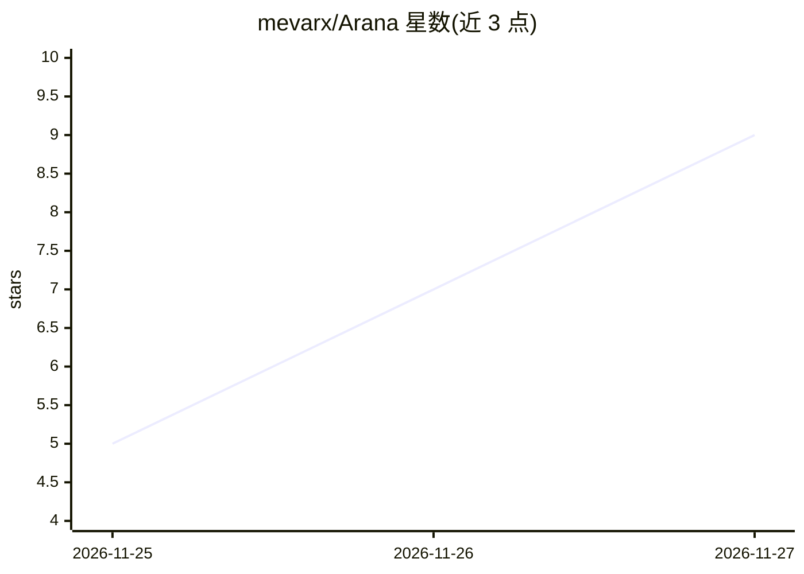

# mevarx/Arana

⭐ 9 · Rust · MIT · 推送 2026-11-24 · [GitHub](https://github.com/mevarx/Arana) · [官网](https://arana.mevarx.xyz/) · 个人维护 · 中文 README

**给 AI Agent 和脚本提供只读网页访问的 Rust CLI 与本地 MCP**

Arana 是一个 Rust 编写的 CLI 工具，附带本地 MCP 服务器（stdio 上的 JSON-RPC 2.0），为 AI Agent 与脚本提供只读的公开网页内容读取：覆盖 web、github、youtube、bilibili、小红书、雪球等 14 个渠道、40 个动作。每次操作返回单一 JSON 信封，含来源 URL、后端尝试记录与结构化错误。不执行发帖、投票、关注等写操作，不索取密码。安装方式为下载各平台压缩包（附 SHA-256 校验）或从源码 cargo 构建。README 明确说明发布验收门槛尚未完全达标，部分宿主集成仅为文档级。

## 筛选速览

| 维度 | 判定 | 备注 |
|---|---|---|
| AI 角色 | `ai-ecosystem` | LLM/agent 周边工具 |
| 许可风险 | `permissive` | MIT |
| 部署形态 | `desktop` | 安装包/桌面程序 |
| 模型依赖 | — | README 未给出锁定关系 |
| 硬件要求 | — | 无带数字的原话,不猜 |
| 安装摩擦 | `low` | 无编译、无系统依赖或容器化 |
| 成熟度 | `idea` | |

## 能力要点

- 14 个渠道、40 个动作的只读网页读取，结果带来源 URL
- 本地 MCP 服务器提供 list_capabilities/read_url/read_many/search 四个工具
- 预置共享 skill 与 11 个 Agent 宿主的接入清单（Hermes、Codex、Claude Code、Cursor 等）
- 结构化抽取支持 CSS 选择器与 --adaptive 抗改版匹配

## 适用场景

- 让 Agent 检索并引用公开网页资料用于研究任务
- 脚本批量抓取页面并做结构化字段抽取
- 通过 MCP 读取视频字幕与转录内容
- 查询股票行情与招聘信息等公开数据

## 场景标签

`网页抓取` · 领域:效率与自动化

## 证据(README 行号)

> L7: Arana reads public web content — pages, repositories, posts, videos, subtitles, stock quotes, and jobs — across 14 p
> L92: `arana mcp` is a local, read-only server that speaks newline-delimited JSON-RPC 2.0 over stdio:
> L103: The repository ships one shared skill (`skills/arana/SKILL.md`) plus manifests and setup instructions for eleven h

## 星数曲线

2026-11-25 5 → 2026-11-27 9（+4）

---
*卡片 v1 · prompt 1.4 · 生成 2026-11-24 · 置信度 high · 依据 README sha `d2cba94379cb` · [字段定义](../../DATASET.md)*
