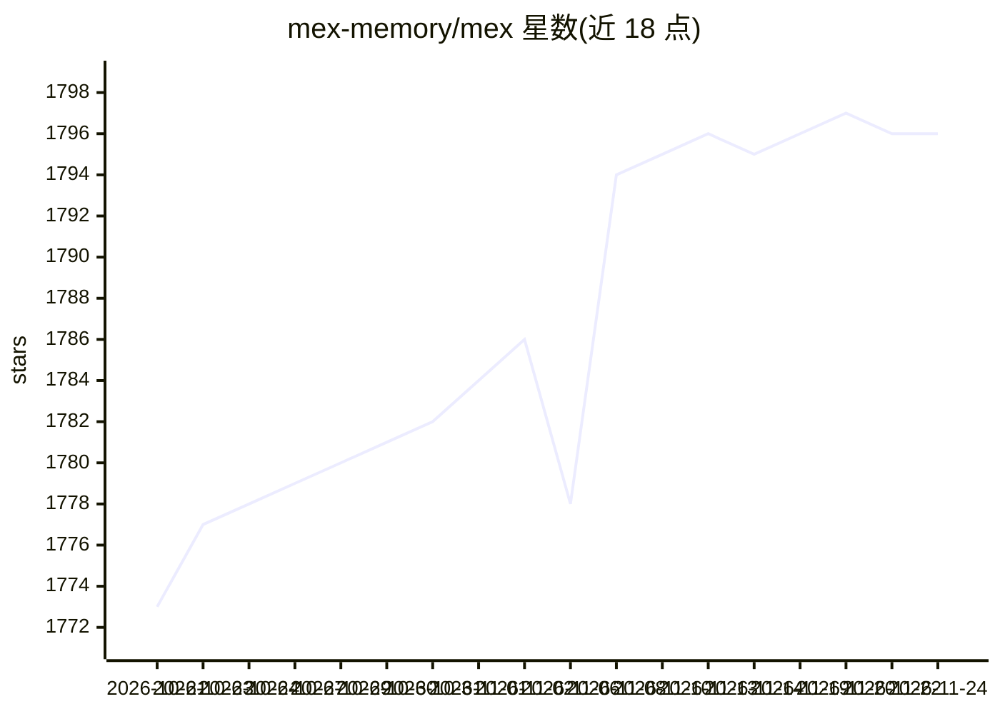

# mex-memory/mex

⭐ 1,796 · TypeScript · MIT · 推送 2026-11-24 · [GitHub](https://github.com/mex-memory/mex) · [官网](https://mexmemory.com) · 组织维护

**给工程师与 AI 编码代理的 Git 共享团队记忆 CLI**

面向 Claude Code 与 Codex 用户的 CLI 工具：开发者用 mex note 保存事实、规则与决策，MEX 将其注入每个新代理会话，并对每条笔记附带针对代码的校验，代码变更使笔记失效时自动扣留、只传递仍成立的内容。笔记保存在本地，通过可评审的 git 分支在团队间共享，还提供 handoff、recall、check 等命令。0.9 beta 需要 Node ≥22.5 及已安装的 Claude Code 或 Codex，无托管服务与 API key，遥测默认开启但可关闭。

## 筛选速览

| 维度 | 判定 | 备注 |
|---|---|---|
| AI 角色 | `ai-ecosystem` | LLM/agent 周边工具 |
| 许可风险 | `permissive` | MIT |
| 部署形态 | `library` | 以包/库形式分发 |
| 模型依赖 | — | README 未给出锁定关系 |
| 硬件要求 | — | 无带数字的原话,不猜 |
| 安装摩擦 | `low` | 无编译、无系统依赖或容器化 |
| 成熟度 | `idea` | |

## 能力要点

- mex note 保存的笔记经代码校验，失效即扣留不投喂
- 通过 Claude Code/Codex 的 hooks 与规则文件在每个新会话送达笔记
- mex share 以 git 分支+PR 形式在团队共享笔记与规则文件
- mex check 离线只读核验，无模型调用

## 适用场景

- 把团队约定（如'日期存 UTC'）告诉一次，让每个新代理会话都遵守
- 代码重构后自动拦截已过时的代理笔记，避免误答
- 通过 PR 审阅在团队成员间分发代理笔记与交接信息

## 场景标签

`编码 Agent` `知识库管理` · 领域:编码与开发

## 证据(README 行号)

> L5: Agents forget between sessions, and the notes you leave them go stale when the code moves. MEX delivers your notes t
> L25: > The beta is a CLI for **Claude Code and Codex**. It has no Hub, MCP server or skills.
> L42: `mex` installs MEX's hooks in your Claude Code and Codex user settings, reads the repo, and shows what your agents 

## 星数曲线

2026-10-21 1,773 → 2026-11-24 1,796（+23）

---
*卡片 v1 · prompt 1.4 · 生成 2026-11-23 · 置信度 high · 依据 README sha `44957a041ef8` · [字段定义](../../DATASET.md)*
