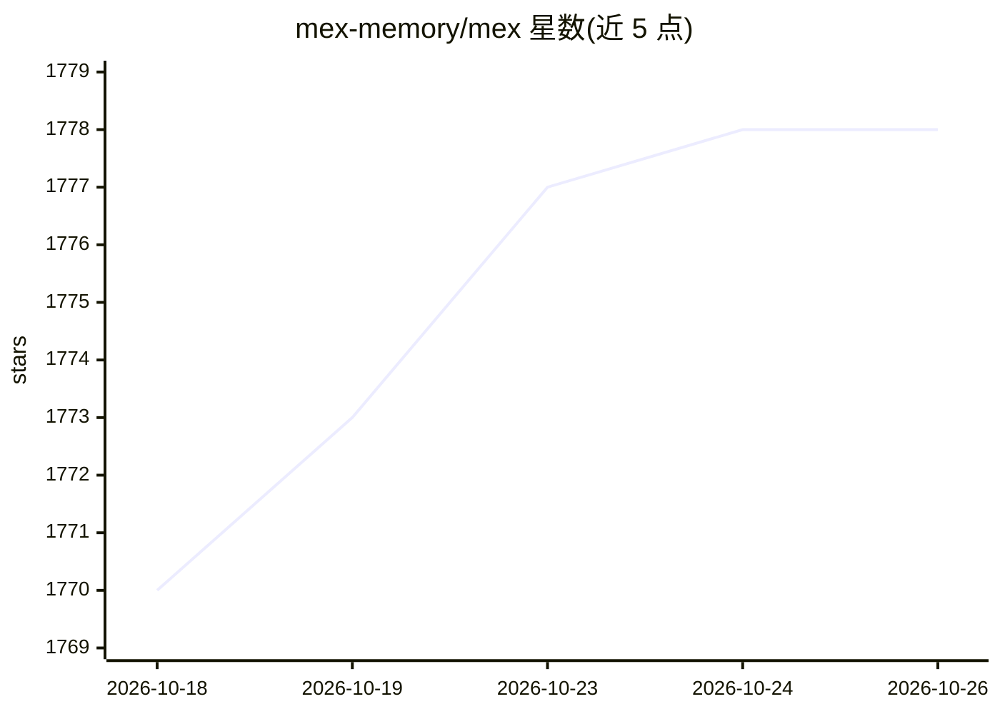

# mex-memory/mex

⭐ 1,778 · TypeScript · MIT · 推送 2026-10-25 · [GitHub](https://github.com/mex-memory/mex) · [官网](https://mexmemory.com) · 组织维护 · 中文 README

**存于代码仓库、经 Git 共享的工程团队与编码 agent 共享记忆工具**

面向工程师团队及其编码 agent（如 Claude Code、Codex）的共享项目记忆工具：以仓库内 Markdown、代码关联 Wiki、待评审的 Inbox 提案、结构化 Relay 交接记录等形式保存架构、决策、需求与上下文；通过普通 Git 提交推送共享，无需托管服务或 Docker。提供本地 Hub（127.0.0.1）供浏览与评审，agent 经项目指令与 CLI 检索维护记忆。要求 Node.js ≥22.5、SQLite FTS5 与 Git 仓库，经 npx 或全局 npm 安装。

## 筛选速览

| 维度 | 判定 | 备注 |
|---|---|---|
| AI 角色 | `ai-ecosystem` | LLM/agent 周边工具 |
| 许可风险 | `permissive` | MIT |
| 部署形态 | `library` | 以包/库形式分发 |
| 模型依赖 | — | README 未给出锁定关系 |
| 硬件要求 | — | 无带数字的原话,不猜 |
| 安装摩擦 | `low` | 无编译、无系统依赖或容器化 |
| 成熟度 | — | 结构信号不足 |

## 能力要点

- Wiki/Inbox/Relay/Code Graph 构成的仓库内团队记忆结构
- 以 Git 为共享层，无托管服务、Docker 或账号要求
- 本地 Hub 浏览与评审记忆，CSRF 保护的会话
- npx 一条命令 setup，支持终端 HUD 与浏览器两种流程

## 适用场景

- 团队成员与编码 agent 共享架构决策与调试上下文
- 把一次会话中的发现交接给下一位接手的工程师
- 让新的编码 agent 会话读取项目已有记忆继续工作

## 场景标签

`Agent 记忆` `知识库管理` · 领域:Agent 开发

## 证据(README 行号)

> L11: MEX keeps your team's architecture, decisions, requirements, and handoffs alongside the code. Engineers and their a
> L30: **What one engineer and their agent learn should become context the next teammate can use.** MEX gives that knowled

## 星数曲线

2026-10-18 1,770 → 2026-10-26 1,778（+8）

---
*卡片 v1 · prompt 1.4 · 生成 2026-10-22 · 置信度 high · 依据 README sha `10202b2f6767` · [字段定义](../../DATASET.md)*
