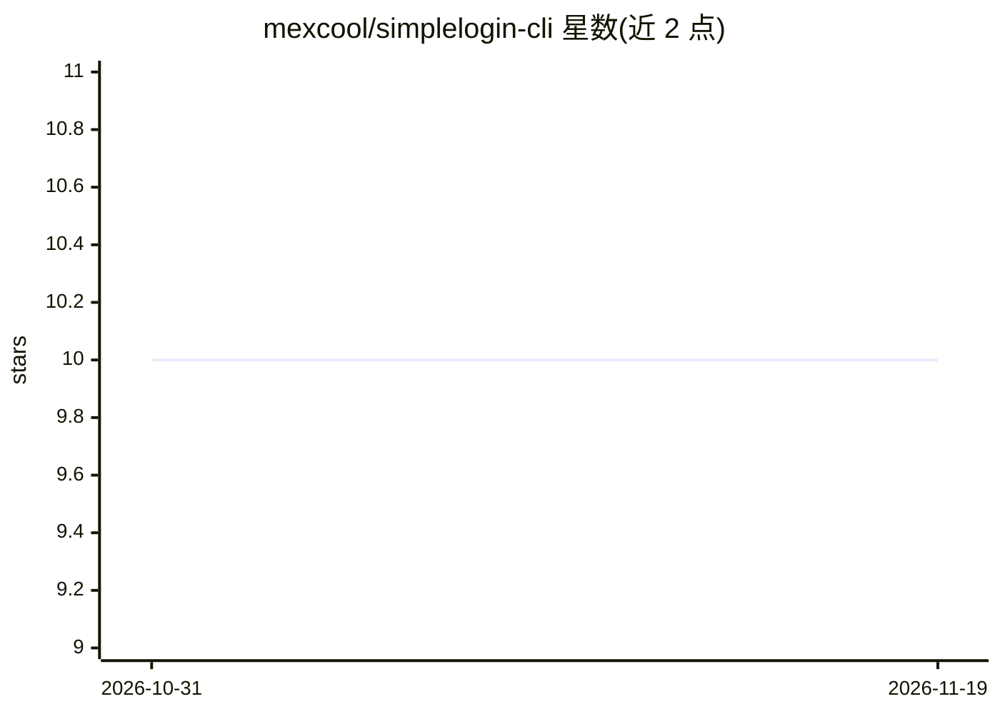

# mexcool/simplelogin-cli

⭐ 10 · Go · MIT · 推送 2026-11-16 · [GitHub](https://github.com/mexcool/simplelogin-cli) · 个人维护

**SimpleLogin 邮件别名的终端管理 CLI，供人类与 agent 使用**

面向 SimpleLogin 邮件别名服务的命令行客户端，以 Go 编写（基于 cobra），支持别名、联系人、邮箱、自定义域名与账户设置的完整管理，并可对接自托管实例。为程序化调用设计：幂等操作、规范退出码（0/1/2）、--json/--jq 机器可读输出、stderr/stdout 分离、渐进式帮助文本。API key 支持环境变量、配置文件、1Password 与 password-store 四种来源。维护上通过每周 GitHub Actions 工作流追踪上游 API 变更并用 Claude Code 自动生成 issue 与修复 PR。

## 筛选速览

| 维度 | 判定 | 备注 |
|---|---|---|
| AI 角色 | `ai-enhanced` | 去掉 AI 部分产品仍成立 |
| 许可风险 | `permissive` | MIT |
| 部署形态 | `desktop` | 安装包/桌面程序 |
| 模型依赖 | — | README 未给出锁定关系 |
| 硬件要求 | — | 无带数字的原话,不猜 |
| 安装摩擦 | `low` | 无编译、无系统依赖或容器化 |
| 成熟度 | — | 结构信号不足 |

## 能力要点

- 完整的别名/联系人/邮箱/域名管理命令集
- 幂等 enable/disable 操作与 0/1/2 退出码便于脚本与 agent 调用
- --json 与 --jq 机器可读输出，数据走 stdout、状态走 stderr
- API key 支持 1Password 与 pass 引用，不落盘

## 适用场景

- 在终端批量管理 SimpleLogin 邮件别名与联系人
- 让 AI agent 通过 CLI 与退出码安全地创建/启停别名
- 对接自托管 SimpleLogin 实例做日常运维
- 导出别名与账户数据为 JSON/CSV 做备份

## 场景标签

 · 领域:开发者工具/电子邮件隐私

## 证据(README 行号)

> L8: A command-line interface for the SimpleLogin email alias service. Manage aliases, contacts, mailboxes, domains, and 
> L292: This CLI is designed for both human and programmatic use.
> L294: **Idempotent operations**: Use `sl alias enable`/`disable` and `sl contact block`/`unblock` instead of `toggle` — 

## 星数曲线

2026-10-31 10 → 2026-11-19 10（+0）

---
*卡片 v1 · prompt 1.4 · 生成 2026-11-19 · 置信度 mid · 依据 README sha `eae185b946e5` · [字段定义](../../DATASET.md)*
