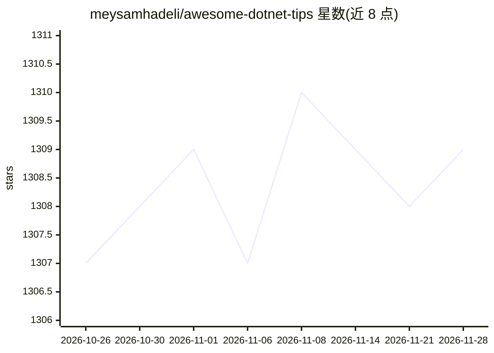

# meysamhadeli/awesome-dotnet-tips

⭐ 1,309 · C# · MIT · 推送 2026-11-26 · [GitHub](https://github.com/meysamhadeli/awesome-dotnet-tips) · 个人维护

**.NET/架构/云原生/数据与 AI 资源的策展清单**

面向 .NET 开发者的资源聚合清单，收录 .NET、软件架构、云原生、数据与 AI 主题的技巧、资源、视频与文章条目。提供 GitHub Pages 部署的网页主页，从 main 分支通过 GitHub Actions 自动构建部署。接受社区贡献，贡献前需遵循贡献指南。采用 MIT 许可证。

## 筛选速览

| 维度 | 判定 | 备注 |
|---|---|---|
| AI 角色 | `ai-knowledge` | 知识聚合/清单类 |
| 许可风险 | `permissive` | MIT |
| 部署形态 | `None` |  |
| 模型依赖 | — | README 未给出锁定关系 |
| 硬件要求 | — | 无带数字的原话,不猜 |
| 安装摩擦 | `low` | 无编译、无系统依赖或容器化 |
| 成熟度 | — | 结构信号不足 |

## 能力要点

- 覆盖 .NET、软件架构、云原生、数据与 AI 的资源收录
- GitHub Pages 网页主页，GitHub Actions 自动部署
- 接受社区贡献并维护贡献指南

## 适用场景

- 查找 .NET 开发、架构与云原生主题的资料
- 按主题浏览社区推荐的技巧与文章

## 场景标签

`精选清单` · 领域:学习与行业

## 证据(README 行号)

> L3: > A curated list of awesome tips and tricks, resources, videos and articles in .NET, Software Architecture, Cloud-Na
> L7: Awesome .NET Tips full homepage

## 星数曲线

2026-10-26 1,307 → 2026-11-28 1,309（+2）

---
*卡片 v1 · prompt 1.4 · 生成 2026-11-23 · 置信度 high · 依据 README sha `370446cdeefb` · [字段定义](../../DATASET.md)*
