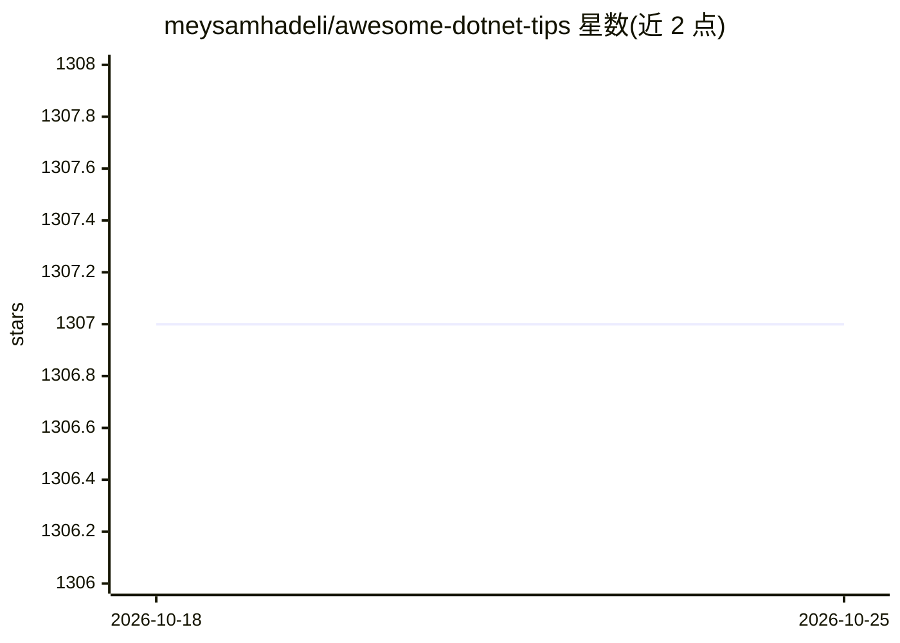

# meysamhadeli/awesome-dotnet-tips

⭐ 1,307 · C# · MIT · 推送 2026-10-10 · [GitHub](https://github.com/meysamhadeli/awesome-dotnet-tips) · 个人维护

**.NET 与软件架构、云原生、数据及 AI 的资源策展清单**

个人维护的 awesome 类策展项目，收录 .NET、C#、软件架构（DDD/CQRS 等）、云原生、数据与 AI 方向的技巧、文章、视频与资源链接。内容按目录组织，并通过 GitHub Pages 自动部署提供网页版浏览入口。仓库以 MIT 许可发布，接受社区按贡献指南提交内容。本身不含代码工具，属知识聚合类资源。

## 筛选速览

| 维度 | 判定 | 备注 |
|---|---|---|
| AI 角色 | `ai-knowledge` | 知识聚合/清单类 |
| 许可风险 | `permissive` | MIT |
| 部署形态 | `None` |  |
| 模型依赖 | — | README 未给出锁定关系 |
| 硬件要求 | — | 无带数字的原话,不猜 |
| 安装摩擦 | `low` | 无编译、无系统依赖或容器化 |
| 成熟度 | — | 结构信号不足 |

## 能力要点

- 收录 .NET、软件架构、云原生、数据与 AI 的文章/视频/技巧链接
- GitHub Pages 自动部署的网页浏览入口
- 按目录分类组织内容

## 适用场景

- 查找 .NET 与软件架构方向的学习资源
- 了解云原生、数据与 AI 相关的 .NET 生态内容

## 场景标签

`精选清单` · 领域:学习与行业

## 证据(README 行号)

> L1: # Awesome .Net Tips
> L3: > A curated list of awesome tips and tricks, resources, videos and articles in .NET, Software Architecture, Cloud-Na

## 星数曲线

2026-10-18 1,307 → 2026-10-25 1,307（+0）

---
*卡片 v1 · prompt 1.4 · 生成 2026-10-21 · 置信度 high · 依据 README sha `77dd0ed7776b` · [字段定义](../../DATASET.md)*
